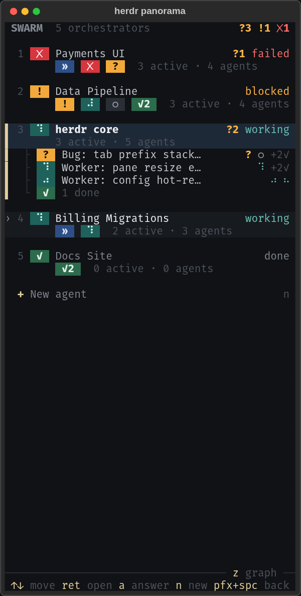

<div align="center">

# herdr panorama

### Every agent you are running, on one live screen.

A swarm view for [herdr](https://herdr.dev): each Claude Code orchestrator, the threads of work it
drives and the subagents it spawned, drawn like an Argo resource graph with small coloured status
squares.

<a href="https://herdr.dev"></a>


<a href="LICENSE"></a>

<br><br>


</div>

**Status: proof of concept.** It implements design 2a "Graph · squares are subagents"
(reference copy and render in [docs/design/](docs/design/)). The design, the data sources and the
open questions are in [docs/DESIGN.md](docs/DESIGN.md).

| Full screen (160 columns) | Side split (70 columns) |
|---|---|
|  |  |

## What it shows

- **Orchestrators**: every herdr pane running Claude Code, named by its tab, with its state
  (failed, blocked, needs you, working, reviewing, idle, all done). The card's left edge shows the
  state and blinks when something needs you, and a bar sweeps along the bottom while it works. It
  also carries `✗` failed,
  `!` blocked (permission prompt or question dialog) and `?N` open
  [herdr-inbox](https://github.com/LeaveMyYard/herdr-inbox) questions.
- **Threads** of the selected orchestrator: native Workflow runs, PR/issue review cycles, or one
  per operator prompt, each with its phases (`✓ author 09:02–09:20`, `» review r2 since 09:43`).
- **Agents** of the selected thread: status, role, model, last tool call, age, tool calls, open
  questions, last message. Finished agents fold into one card.

Status is colour and glyph: `?` needs answer · `!` blocked · `✗` failed · `⠋` running ·
`»` reviewing · `○` queued · `✓` done · `✓?` done, inferred from silence (not recorded) ·
`~` lost (needs the Claude Code plugin) · `-` cancelled.

It never types into a pane. Its only actions are focusing a pane (`g`) and opening the
herdr-inbox popup (`a`, `i`) when that plugin is installed.

## Requirements

herdr ≥ 0.9.0 (Linux or macOS), Claude Code, [`uv`](https://docs.astral.sh/uv/) on `PATH`.

## Install (herdr plugin)

```sh
herdr plugin install LeaveMyYard/herdr-panorama
```

Bind a key in `~/.config/herdr/config.toml`, then `herdr server reload-config`:

```toml
[[keys.command]]
key = "prefix+space"
type = "plugin_action"
command = "leavemyyard.herdr-panorama.open"
description = "swarm view"
```

`leavemyyard.herdr-panorama.open-split` opens it in a side split instead of the full-screen popup.

## Use it as your home tab

By default panorama lives in its own tab, `◆ panorama`, first in the tab bar:

- herdr's startup hook opens it once. If it is already there it is reused,
  never opened a second time.
- The key (`prefix+space`) jumps back to it from anywhere, and opens it again
  if you closed it.
- **Enter** on an orchestrator, or **g** on any card, goes to that agent's pane.
  In the home tab, `a`/`i` open the inbox over panorama, and nothing closes it
  except `q`.
- **`+ New agent`** (the row under the orchestrator cards, or **n**) starts a new
  Claude Code agent. Fill in a name, a working directory and an optional first
  prompt. The name is also the tab label, and it is made to fit herdr's agent
  names (`Billing export` becomes `billing-export`).
- On submit panorama creates the tab, starts Claude Code there and, if you gave
  one, sends the first prompt once. This is the only time panorama types into a
  pane, and only on your submit.


To use the popup instead, set `home_tab = false` in the plugin's `config.toml`. The action
`leavemyyard.herdr-panorama.open-popup` always opens the popup.

### Cockpit (experimental)

With herdr's sidebar hidden, panorama can sit as the agent list on the left of the agent
you are working with. Turn it on in the plugin's `config.toml`:

```toml
cockpit = true        # default false while experimental
cockpit_width = 46    # panorama's columns on the left
cockpit_follow = true # follow you to whichever orchestrator tab you switch to (default true)
cockpit_follow_tabs = "any" # "single": only into tabs where the orchestrator is the only pane
```

- **Enter** on an orchestrator (or **g**, or a click on the selected card) moves panorama's
  own pane into that agent's tab, on its left, and focuses the agent. The agent never
  moves: closing a tab closes that agent's tab, as always, and panorama with it.
- **It follows you.** Switch tabs any other way (the tab bar, `prefix+1..9`, a
  notification, `herdr agent focus`), and when you land on a Claude orchestrator's tab the
  panel moves there too, beside the agent. You stay exactly where you clicked. It never
  moves for tabs without an orchestrator, other workspaces, while you are in panorama
  itself, in the New agent form or zoomed, and it acts once per switch. By default it
  also docks into tabs you split (`cockpit_follow_tabs = "single"` keeps it out of those).
  With two clients attached to one herdr session, either one's tab switches move it, so
  turn `cockpit_follow` off there.
- **z** zooms panorama to the whole tab (the full graph) and back to the panel.
- `prefix+space` takes you back to the list wherever it is; if panorama was closed, it
  opens again in its home tab.
- In a tab with several panes, panorama docks left of the agent's own pane.
- Docked, panorama shows the compact list from design 3a with design 9e's coloured tiles:
  per orchestrator its tab number, a state tile, `?N` and one tile per thread; the docked one
  lists its threads (a tile each) with their agents instead.

  
- `cockpit = false` stops docking at the next Enter, and brings panorama back to its own
  first tab at the next `prefix+space` or start.
- If you split the home tab and run something next to panorama, docking renames that tab
  to the agent's name first, so nothing is left under panorama's label.

## Optional: Claude Code plugin

The view works without it. The plugin adds, for the sessions where it is installed:

- `SubagentStart` / `SubagentStop` hooks that record exact start and stop times. Agents that
  ended then show as a confirmed `done` instead of `done?`. An agent that started but never
  stopped, and whose Claude process is gone, shows as `lost`.
- an MCP tool, `report_thread(thread_id, title, phase, phases_done, next, status, agents)`, that
  orchestrators call to declare threads and phases (the same format as `panorama emit`);
- one short line of session instructions (inside herdr only) asking orchestrators to use it.

```
/plugin install herdr-panorama --marketplace LeaveMyYard/herdr-panorama
```

or `claude plugin marketplace add LeaveMyYard/herdr-panorama` then
`claude plugin install herdr-panorama@herdr-panorama`. The hooks need `python3` on `PATH` (stdlib only); the MCP server needs `uv`.

## Configure

`config.toml` in the plugin's config dir (`herdr plugin config-dir leavemyyard.herdr-panorama`):

```toml
done_window = "1h"   # how long finished threads stay visible (seconds, or "90m", "2h30m")
home_tab = true      # panorama in its own first tab (false: the key opens a popup)
cockpit = false      # experimental: panorama docked left of the selected agent (see above)
cockpit_width = 46   # the list's width in the cockpit
cockpit_follow = true # the cockpit follows you to the orchestrator tab you switch to
cockpit_follow_tabs = "any" # or "single": follow only into one-pane orchestrator tabs
machines = "all"     # herdr's saved SSH machines to show: "all", "none" or ["label", ...]
highlight_unseen = true # pulse what failed, asked or finished since you last looked
animation_fps = 20   # how smoothly pulses and blinks fade (2..30): lower it on a slow terminal or remote link
```

**Unseen.** A new failure, a new question or a finished agent makes its card pulse slowly in
the event's colour (red, amber, green; the most urgent wins), and its thread and orchestrator
with it. A finished agent makes them pulse more quietly. In the docked panel the orchestrator's
two lines and the thread glyph pulse. It stops when you click the card, press Enter on it,
go to or dock next to its orchestrator, or focus that pane in herdr. The marks survive a
restart and are shared by every panorama of the machine.

**Other machines.** Agents on herdr's saved SSH machines (`herdr machine list`) appear in the
same view under a faint `─ <machine> ─` divider. Enter on one focuses it on that machine and
tells you to switch herdr there. Panorama reads their herdr state through `herdr --machine`
and their Claude transcripts over ssh (batch mode, never prompting). A machine that does not
answer shows as stale or unreachable and never slows the local view. See
[docs/REMOTE.md](docs/REMOTE.md).

The default is 1 hour. The `PANORAMA_DONE_WINDOW` environment variable overrides it.

## Use

| Key | Action |
|---|---|
| `↑` `↓` / `j` `k` | Move in the focused column |
| `→` `l` / `enter` | Open the next column (`enter` on a folded card unfolds it) |
| `←` `h` | Back |
| `g` | Go to the orchestrator's pane |
| `a` | Answer: herdr-inbox opened on that agent's (or orchestrator's) questions, the pane for blocking prompts. Click: `a answer` in an agent card, `?N` on an orchestrator card |
| `i` | herdr-inbox |
| `t` | Show the transcript path |
| `f` | Filter: all / running / needs me |
| `n` | New agent (also Enter on the `+ New agent` row) |
| `q` `esc` | Close (in the home tab only `q`) |

The mouse works too, in both layouts: click a card to select it, click the
selected card again to go to its pane, click `✓ n complete` / `n finished` to
unfold, `+ New agent` for the form, the header's `all` / `running` /
`needs me` to filter, and `g` / `t` / `a` in an expanded agent card to act.
The wheel scrolls a column. A card that a refresh just moved under the pointer
ignores clicks for a second.

From a shell:

```sh
uv run panorama snapshot            # text summary of the derived model
uv run panorama snapshot --json     # the full model
uv run panorama snapshot --counts   # numbers only
uv run panorama tui
```

## Development

```sh
uv sync
uv run pytest                            # tests (fake herdr, captured fixtures)
uv run pytest tests/make_screenshots.py  # regenerate docs/screenshots (needs Chrome)
uv run --with pillow python docs/screenshots/hero_gif.py  # the README GIF (needs Chrome and ffmpeg)
```

`tools/accuracy.py` compares agent statuses against an independent checker on real sessions
(read-only; see DESIGN.md "Accuracy").

## Credits

The session scanner (`src/herdr_panorama/scan/`) is a Python port of the discovery, linking,
record parsing and tailing of [zoetrope](https://github.com/furkankly/zoetrope) v0.2.0, Copyright (c) 2026 Furkan Kalaycioglu,
MIT ([LICENSES/zoetrope-MIT.txt](LICENSES/zoetrope-MIT.txt)), with fixes for resumed, killed and
nested agents.

## License

MIT
