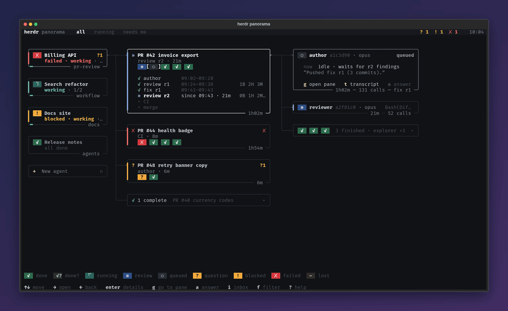
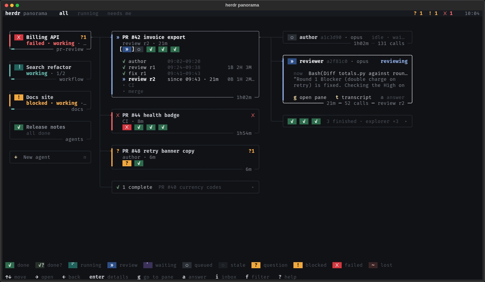
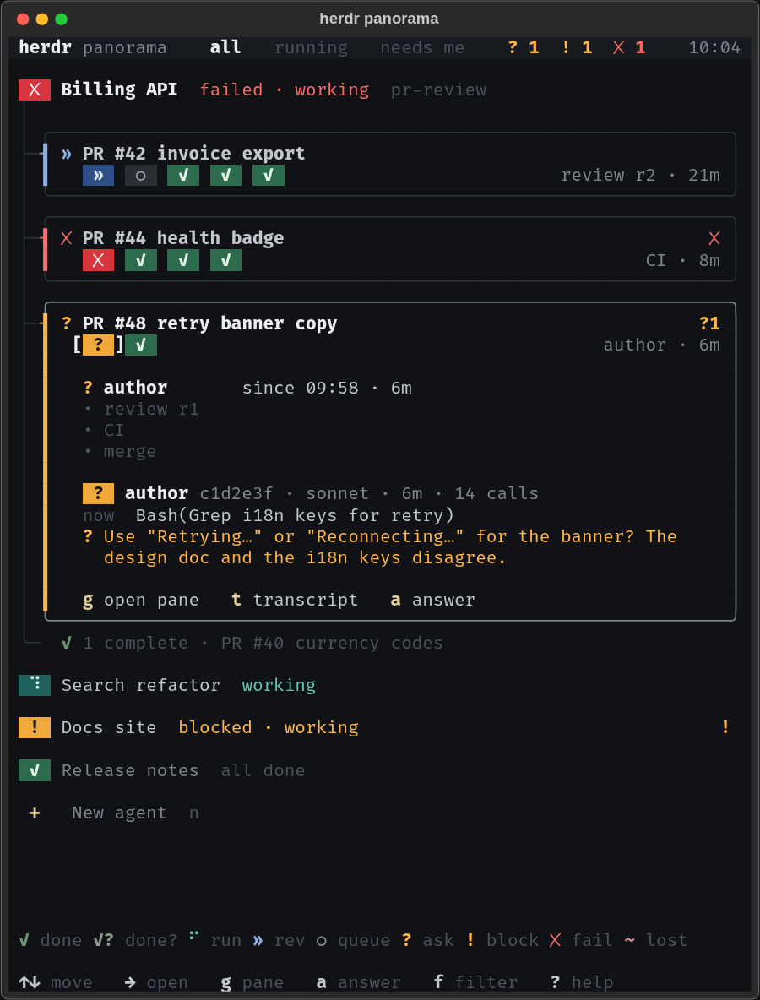
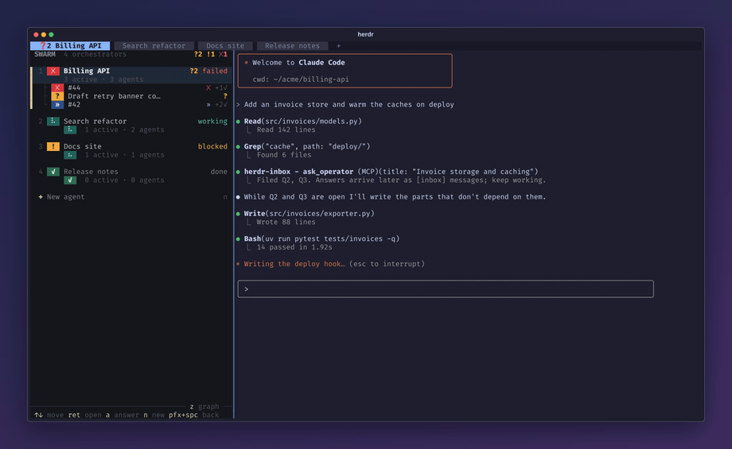
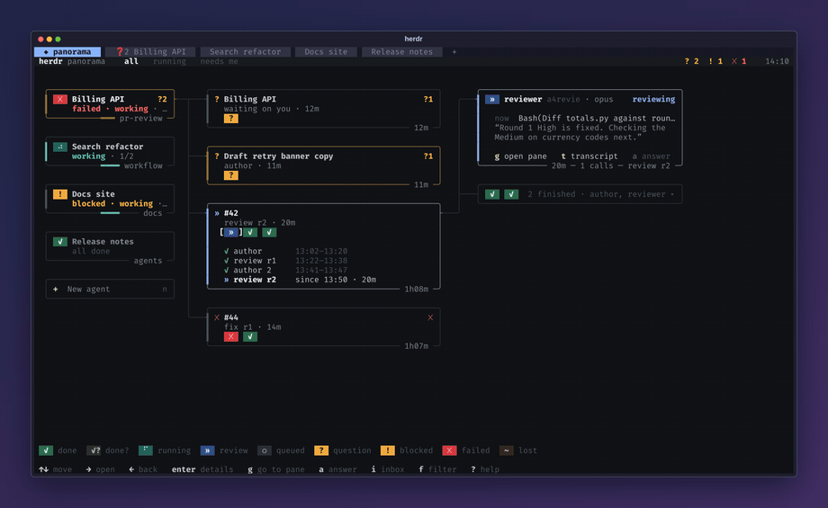
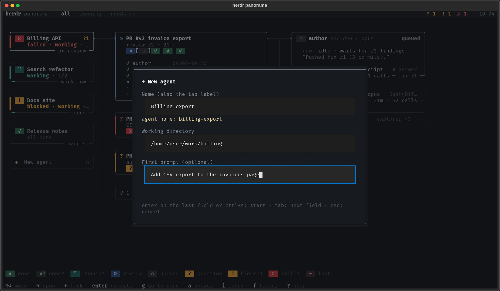

<p align="center"></p>

<h3 align="center">Run a swarm of Claude Code agents in herdr and see, at a glance, which one needs you</h3>

<p align="center">herdr panorama draws every Claude Code orchestrator in your <a href="https://herdr.dev">herdr</a> session, the threads of work it drives and the subagents it spawned, like an Argo resource graph with small coloured status tiles. It reads what Claude Code already writes, types into a pane only when you start a new agent from it, and puts what failed, blocked or asked a question in front.</p>

<p align="center"><a href="docs/media/herdr-demo.mp4"></a></p>

```sh
herdr plugin install LeaveMyYard/herdr-panorama
```

<p align="center"><sub>✓&nbsp;Free,&nbsp;MIT&nbsp;licensed &nbsp; ✓&nbsp;Reads&nbsp;local&nbsp;transcripts,&nbsp;no&nbsp;hosted&nbsp;service &nbsp; ✓&nbsp;macOS&nbsp;and&nbsp;Linux,&nbsp;herdr&nbsp;0.9+</sub></p>

<p align="center">
<a href="https://herdr.dev"></a>


<a href="LICENSE"></a>
</p>

Then give it a key. `prefix+space` is the suggested default; any herdr key works, including one
without the prefix such as `ctrl+alt+p`. Add this to `~/.config/herdr/config.toml` and run
`herdr server reload-config`:

```toml
[[keys.command]]
key = "prefix+space"          # change to taste, e.g. "ctrl+alt+p"
type = "plugin_action"
command = "leavemyyard.herdr-panorama.open"
description = "swarm view"
```

**Status: proof of concept.** It implements design 2a "Graph · squares are subagents"
(reference copy and render in [docs/design/](docs/design/)). The design, the data sources and the
open questions are in [docs/DESIGN.md](docs/DESIGN.md).

| Full screen (160 columns) | Side split (70 columns) |
|---|---|
|  |  |

## Pick your setup

### 🗺️ Graph only: panorama in its own tab

The default. Panorama opens as the first tab, `◆ panorama`, and your key jumps back to it from
anywhere. Enter on an orchestrator goes to its pane; the full graph stays one key away. Details
in [Use it as your home tab](#use-it-as-your-home-tab).

```toml
# plugin config.toml (herdr plugin config-dir leavemyyard.herdr-panorama)
home_tab = true    # the default
cockpit = false    # the default
```

### 🧭 Cockpit: a slim list beside the agent you are working with

Every orchestrator's tab gets a narrow panorama panel on its left, with that agent's chat on the
right. ↑/↓ in a panel switch to the next chat, its tab and its panel, while the keyboard stays in
the panels; Enter goes into the agent, and your open key brings you back. With herdr's own
sidebar hidden, the panels become the agent list. The panel's background shows where the keyboard is: `#14161b` while panorama has it,
`#101215` when the agent does. Still experimental; details in [Cockpit](#cockpit-experimental).

<div align="center">
<a href="docs/media/cockpit.mp4"></a>
</div>

```toml
# plugin config.toml
home_tab = true
cockpit = true
cockpit_width = 46            # panorama's columns on the left
cockpit_follow_tabs = "any"   # "single": a panel only in tabs where the agent is the only pane
dock_keep_focus = true        # switching chats keeps the keyboard on panorama
dock_on_arrows = true         # ↑/↓ switch the chats (after 0.2 s); Enter goes into the agent
panel_colors = "fixed"        # or "herdr": take the panel colours from herdr's theme
# panel_bg = "#101215"        # the panel while the agent has the keyboard
# focus_bg = "#14161b"        # the panel while panorama has it
```

```toml
# ~/.config/herdr/config.toml
[ui]
sidebar_start_collapsed = true     # takes effect at herdr's next launch
sidebar_collapsed_mode = "hidden"  # no rail: panorama is the agent list
pane_outer_borders = false         # no frame around the pane area
pane_gaps = false                  # panorama and the agent share one divider
# pane_borders = "off"             # optional, see below

[[keys.command]]
key = "ctrl+alt+p"                 # a key without the prefix, one press from anywhere
type = "plugin_action"
command = "leavemyyard.herdr-panorama.open"
description = "swarm view"
```

**Recommended: turn herdr's pane borders down.** The cockpit is a split, so by default herdr
frames the pane area and gives panorama and the agent a border each with a gap between them.
Every one of those lines is a column taken from the 46-column panel (and from the agent's
chat), and the frame makes the panel look boxed in rather than part of the screen.
`pane_outer_borders = false` drops the outer frame and `pane_gaps = false` leaves a single
shared divider between panorama and the agent. `pane_borders = "off"` removes that divider
too, for the cleanest look; the trade-off is that panorama and the agent are then separated
only by their backgrounds, and every other split pane in herdr loses its border as well (and
with it the agent labels `show_agent_labels_on_pane_borders` draws there).

## Works great with herdr-inbox

Many agents means many questions. [herdr-inbox](https://github.com/LeaveMyYard/herdr-inbox) lets
them ask without stopping: each question is filed once, the agent keeps working, and you answer
every agent's questions from one popup. Panorama shows each open question as `?N` on its card;
`a` opens the inbox right on it, and the answer lands back in the agent's conversation.

<div align="center">
<a href="docs/media/herdr-demo.mp4"></a>
</div>

```sh
claude plugin marketplace add LeaveMyYard/herdr-inbox
claude plugin install herdr-inbox@herdr-inbox
herdr plugin install LeaveMyYard/herdr-inbox
```

## What it shows

- **Orchestrators**: every herdr pane running Claude Code, named by its tab, with its state
  (failed, blocked, needs you, working, reviewing, waiting, stale, idle, all done). **Waiting** ⠁ (a dot circling the cell):
  herdr says idle, but a Bash it put in the background or a Monitor watch is still running, so it
  will wake up by itself; its tasks are listed. **Stale** ◌: idle for longer than `stale_after`
  (12 h), probably forgotten. The card's left edge shows the
  state and blinks when something needs you, and a bar sweeps along the bottom while it works. It
  also carries `✗` failed,
  `!` blocked (permission prompt or question dialog) and `?N` open
  [herdr-inbox](https://github.com/LeaveMyYard/herdr-inbox) questions.
- **Threads** of the selected orchestrator: native Workflow runs, PR/issue review cycles, or one
  per operator prompt, each with its phases (`✓ author 09:02–09:20`, `» review r2 since 09:43`).
- **Agents** of the selected thread: status, role, model, last tool call, age, tool calls, open
  questions, last message. Finished agents fold into one card.

Status is colour and glyph: `?` needs answer · `!` blocked · `✗` failed · `⠋` running ·
`»` reviewing · `⠁` waiting on its background work · `○` queued · `✓` done · `✓?` done, inferred from silence (not recorded) ·
`~` lost (needs the Claude Code plugin) · `-` cancelled.

It never types into a pane. Its only actions are focusing a pane (`g`) and opening the
herdr-inbox popup (`a`, `i`) when that plugin is installed.

## Requirements

- **herdr ≥ 0.9.0** on Linux or macOS ([herdr.dev](https://herdr.dev)).
- **Claude Code**, any version that writes transcripts under `~/.claude/projects`
  (`CLAUDE_CONFIG_DIR` is honoured). The optional Claude Code plugin below needs plugin support.
- **[uv](https://docs.astral.sh/uv/)** on herdr's `PATH`; it brings its own Python 3.11+. The
  optional plugin's hooks use the system `python3`, resolved once and then run directly (no
  version-manager shim on every hook).

## Install (herdr plugin)

```sh
herdr plugin install LeaveMyYard/herdr-panorama
```

Bind a key in `~/.config/herdr/config.toml`, then `herdr server reload-config`:

```toml
[[keys.command]]
key = "prefix+space"
type = "plugin_action"
command = "leavemyyard.herdr-panorama.open"
description = "swarm view"
```

`leavemyyard.herdr-panorama.open-split` opens it in a side split instead of the full-screen popup.

## Use it as your home tab

By default panorama lives in its own tab, `◆ panorama`, first in the tab bar:

- herdr's startup hook opens it once. If it is already there it is reused,
  never opened a second time.
- The key (`prefix+space`) jumps back to it from anywhere, and opens it again
  if you closed it.
- **Enter** on an orchestrator, or **g** on any card, goes to that agent's pane.
  In the home tab, `a`/`i` open the inbox over panorama, and nothing closes it
  except `q`.
- **`+ New agent`** (the row under the orchestrator cards, or **n**) starts a new
  Claude Code agent. Fill in a name, a working directory and an optional first
  prompt. The name is also the tab label, and it is made to fit herdr's agent
  names (`Billing export` becomes `billing-export`).
- On submit panorama creates the tab, starts Claude Code there and, if you gave
  one, sends the first prompt once. This is the only time panorama types into a
  pane, and only on your submit.



To use the popup instead, set `home_tab = false` in the plugin's `config.toml`. The action
`leavemyyard.herdr-panorama.open-popup` always opens the popup.

### Cockpit (experimental)

With herdr's sidebar hidden, panorama can sit as the agent list on the left of every
orchestrator's tab: one panel per tab, drawn from the home panorama (which stays in its own
tab). Turn it on in the plugin's `config.toml`:

```toml
cockpit = true        # default false while experimental
cockpit_width = 46    # the panels' columns on the left
cockpit_follow_tabs = "any" # "single": a panel only in tabs where the orchestrator is the only pane
dock_keep_focus = true # switching chats leaves the keyboard in the panels (default true)
dock_on_arrows = true  # ↑/↓ in a panel switch the chats (default true)
```

The single panel that moved between tabs (`cockpit_panels = "moving"`, and `cockpit_follow`) is
gone: an old `cockpit_panels` setting is ignored, and every tab gets its own panel. A home view
that an older version left docked beside an agent goes back to its own first tab at the next
start or open key.

**Upgrading from the moving panel by restarting herdr:** if the home view was docked beside an
agent when herdr stopped, herdr's session restore brings that pane back as a plain shell still
labelled `◆ panorama`. Panorama never closes it: the older version kept no record that would
prove the shell is its own unused pane. Close it by hand in that tab.

- **Panels.** When the home panorama starts, every orchestrator tab gets its panel on the left
  of the agent. A tab that gets an orchestrator later gets its panel when you visit it. Agents
  never move; closing a tab closes its panel with it.
- **Browse the chats.** In a panel, ↑/↓ switch the chats themselves: once the arrows rest for
  0.2 s, herdr shows the highlighted orchestrator's tab with the keyboard on its panel. A click
  on another orchestrator does the same at once. **Enter** (or **g**) goes into the highlighted
  agent; your open key brings you back.
- `dock_on_arrows = false`: the arrows only move the highlight, and Enter on another
  orchestrator switches to it, keeping the keyboard in the panels (Enter on this tab's own one
  goes into it). `dock_keep_focus = false`: Enter always goes into the agent, and the arrows
  never switch (they would leave the keyboard in an agent).
- **Closed stays closed.** Close a tab's panel and that tab stays without one; your open key in
  that tab makes and focuses a new one. Elsewhere the open key takes you to the home tab.
- Docked, panorama shows the compact list from design 3a with design 9e's coloured tiles:
  per orchestrator its tab number, a state tile, `?N` and one tile per thread; the docked one
  lists its threads (a tile each) with their agents instead.
- The panel's background shows whether panorama has the keyboard: `#14161b` while it does,
  `#101215` when not. `panel_bg` / `focus_bg` in panorama's config change them;
  `panel_colors = "herdr"` takes them from herdr's theme instead (`[theme]` and
  `[theme.custom]` in herdr's `config.toml`, with `focus_tint`).

  
- `cockpit = false` closes every panel.

## Optional: Claude Code plugin

The view works without it. The plugin adds, for the sessions where it is installed:

- `SubagentStart` / `SubagentStop` hooks that record exact start and stop times. Agents that
  ended then show as a confirmed `done` instead of `done?`. An agent that started but never
  stopped, and whose Claude process is gone, shows as `lost`.
- an MCP tool, `report_thread(thread_id, title, phase, phases_done, next, status, agents)`, that
  orchestrators call to declare threads and phases (the same format as `panorama emit`);
- one short line of session instructions (inside herdr only) asking orchestrators to use it.

```
/plugin install herdr-panorama --marketplace LeaveMyYard/herdr-panorama
```

or `claude plugin marketplace add LeaveMyYard/herdr-panorama` then
`claude plugin install herdr-panorama@herdr-panorama`. The hooks need `python3` on `PATH` (stdlib only): the interpreter it resolves to is cached in the plugin's
data directory (`${CLAUDE_PLUGIN_DATA}/python-interpreter`) and run directly afterwards, so a pyenv-style shim
costs its 60–75 ms once, not on every hook. The MCP server needs `uv`.

## Configure

`config.toml` in the plugin's config dir (`herdr plugin config-dir leavemyyard.herdr-panorama`):

```toml
done_window = "1h"   # how long finished threads stay visible (seconds, or "90m", "2h30m")
home_tab = true      # panorama in its own first tab (false: the key opens a popup)
cockpit = false      # experimental: a panorama panel left of every orchestrator (see above)
cockpit_width = 46   # the panels' width
cockpit_follow_tabs = "any" # or "single": panels only in one-pane orchestrator tabs
dock_keep_focus = true # panels: switching chats keeps the keyboard in the panels
dock_on_arrows = true  # panels: ↑/↓ switch the chats; Enter goes into the agent
panel_colors = "fixed" # docked panel background: "fixed" (#14161b focused, #101215 not) or "herdr" (herdr's theme)
# panel_bg = "#101215"  # the unfocused background, in either mode
# focus_bg = "#14161b"  # the focused background, in either mode
focus_tint = 0.15      # "herdr" mode: how far focus moves panel_bg toward the theme's active_row_bg
machines = "all"     # herdr's saved SSH machines to show: "all", "none" or ["label", ...]
highlight_unseen = true # pulse what failed, asked or finished since you last looked
animation_fps = 20   # how smoothly pulses and blinks fade (2..30): lower it on a slow terminal or remote link
stale_after = "12h"  # an orchestrator idle this long (nothing in flight) reads "stale"
```

**Unseen.** A new failure, a new question or a finished agent makes its card pulse slowly in
the event's colour (red, amber, green; the most urgent wins), and its thread and orchestrator
with it. A finished agent makes them pulse more quietly. In the docked panel the orchestrator's
two lines and the thread glyph pulse. It stops when you click the card, press Enter on it,
go to or dock next to its orchestrator, or focus that pane in herdr. The marks survive a
restart and are shared by every panorama of the machine.

**Other machines.** Agents on herdr's saved SSH machines (`herdr machine list`) appear in the
same view under a faint `─ <machine> ─` divider. Enter on one focuses it on that machine and
tells you to switch herdr there. Panorama reads their herdr state through `herdr --machine`
and their Claude transcripts over ssh (batch mode, never prompting). A machine that does not
answer shows as stale or unreachable and never slows the local view. See
[docs/REMOTE.md](docs/REMOTE.md).

The default is 1 hour. The `PANORAMA_DONE_WINDOW` environment variable overrides it.

## Use

| Key | Action |
|---|---|
| `↑` `↓` / `j` `k` | Move in the focused column |
| `→` `l` / `enter` | Open the next column (`enter` on a folded card unfolds it) |
| `←` `h` | Back |
| `g` | Go to the orchestrator's pane |
| `a` | Answer: herdr-inbox opened on that agent's (or orchestrator's) questions, the pane for blocking prompts. Click: `a answer` in an agent card, `?N` on an orchestrator card |
| `i` | herdr-inbox |
| `t` | Show the transcript path |
| `f` | Filter: all / running / needs me |
| `n` | New agent (also Enter on the `+ New agent` row) |
| `q` `esc` | Close (in the home tab only `q`) |

The mouse works too, in both layouts: click a card to select it, click the
selected card again to go to its pane, click `✓ n complete` / `n finished` to
unfold, `+ New agent` for the form, the header's `all` / `running` /
`needs me` to filter, and `g` / `t` / `a` in an expanded agent card to act.
The wheel scrolls a column. A card that a refresh just moved under the pointer
ignores clicks for a second.

From a shell:

```sh
uv run panorama snapshot            # text summary of the derived model
uv run panorama snapshot --json     # the full model
uv run panorama snapshot --counts   # numbers only
uv run panorama tui
```

## FAQ and troubleshooting

**The key does nothing.** Bind it first (top of this page), then `herdr server reload-config`.
`herdr plugin list` should show `leavemyyard.herdr-panorama` enabled, and `herdr plugin log`
shows its action and startup logs, including a missing `uv`.

**An agent is missing.** Panorama lists the panes where herdr detects Claude Code
(`herdr agent list`) and reads their transcripts from `~/.claude/projects`. A pane whose agent
herdr does not see does not get a card.

**Agents show `done?` or `lost`.** Without the optional Claude Code plugin, an agent's end is
inferred from silence. Install it (above) for exact start and stop times.

**Does it change my agents or send anything anywhere?** It reads herdr's state and the local
transcripts, focuses panes and opens the inbox when you ask. It types into a pane only when you
submit the New agent form. Other machines are read over your own SSH; nothing goes to a hosted
service.

**I don't want the `◆ panorama` tab.** Set `home_tab = false`; the key then opens a popup.

**The cockpit panel sits next to herdr's sidebar.** Hide herdr's sidebar with the `[ui]` settings
in [Pick your setup](#-cockpit-a-slim-list-beside-the-agent-you-are-working-with), then restart
herdr.

## Development

```sh
uv sync
uv run pytest                            # tests (fake herdr, captured fixtures)
uv run pytest tests/make_screenshots.py  # regenerate docs/screenshots (needs Chrome)
uv run --with pillow python docs/screenshots/hero_gif.py  # the README GIF (needs Chrome and ffmpeg)
```

`tools/accuracy.py` compares agent statuses against an independent checker on real sessions
(read-only; see DESIGN.md "Accuracy").

## Contributing

Contributions are welcome. Start with [CONTRIBUTING.md](CONTRIBUTING.md) (how to build, test and send a PR; the Python code is on a bug-fix-only freeze while the Rust port is in progress). Please follow the [Code of Conduct](CODE_OF_CONDUCT.md); report security problems as described in [SECURITY.md](SECURITY.md).

## Credits

The session scanner (`src/herdr_panorama/scan/`) is a Python port of the discovery, linking,
record parsing and tailing of [zoetrope](https://github.com/furkankly/zoetrope) v0.2.0, Copyright (c) 2026 Furkan Kalaycioglu,
MIT ([LICENSES/zoetrope-MIT.txt](LICENSES/zoetrope-MIT.txt)), with fixes for resumed, killed and
nested agents.

## License

MIT
