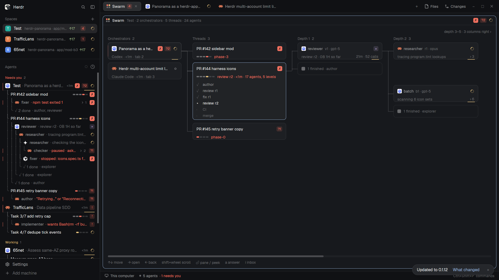

# Panorama for herdr-app

A native Agents sidebar and per-space Swarm graph show orchestrators, threads
and their spawned agents. Pane-less agents open Peek, with a read-only transcript
viewer. Native roots stay visible when no transcript can be associated safely.

This preview is a real native renderer capture on synthetic design data, not
proof of natural rich-session collection. See [capture provenance](../docs/review/herdr-app/b3/FINAL.md).
It reuses the B3 capture at source `92babb4ccadc28397674d8738cb6611252cd1fda`
(1920×1080, zoom 1.2), unchanged from `final-renderer-d.png`; SHA256
`4c160bee8867e80d41b279b09f09c99c5cee1cc0a32f78d7820ba36cf70608ee`.
It is a seeded stale-client renderer frame, not the actual basic-root writer smoke
or a capture of later Peek behavior.

## What you see

The cloned main layout keeps the native workspace chrome, terminal area, Files,
Changes and status bar. A 320 logical-pixel sidebar has a 46px brand header,
content-sized Spaces list and the remaining height for Agents; the footer is 69px.
The narrow rail below 160px keeps the compact stock presentation.

Needs-you is coral (`blocked`), work is amber (`working`), unseen done is blue
(`done`), review is `ansi5`, and idle uses `idle`. Other colors come from theme()
so the layout follows the app theme. Orchestrator rows are 30px; thread/agent rows
are 26px, with 13px tree segments and native harness icons.

Swarm uses fixed-width columns: orchestrators 236px, threads 300px, each spawn
depth 272px, with 36px gaps. A selected thread shows phases; a selected agent shows
activity/questions/error and available actions. Hidden columns have breadcrumbs
and a scrollbar. Peek is 284px wide with status, supplied metadata, error and last
message, plus Open orchestrator and Transcript.

## How it behaves

- Keep every stock root and recursive native terminal child. Enrich only exact
  verified core addresses; never infer ownership from names, folders or agent IDs.
- Needs-you, Done, Working and Idle follow urgency, with pinned agents first.
  Working is a native spinner; review is `»`, wait `?N`, permission `!`, failure
  a solid `✗`, done a check/dot, idle a ring. Threads aggregate descendants.
- Threads remain visible where there is news; finished sibling groups fold.
  User folds override defaults until their subtree status changes.
- Space clicks create Swarm once at tab index 1, then select it. Never keep moving
  an existing tab against a user's drag. Retain stock Spaces git/worktree/machine
  behavior and stock terminal-tab behavior.
- Sidebar root clicks focus their verified terminal; native terminal children
  can peek; transcript-only agents open the mod's popup. In Swarm, root/thread
  clicks select/drill, Enter/double-click opens the root, and agent clicks open it.
- Arrows/hjkl navigate spawn depth; wheel scrolls columns independently and
  shift-wheel moves the horizontal window. Guard moved targets for 300ms after
  scroll and 1s after refresh. Animate needs borders and working sweeps only
  when visible; keep native spinner timing 900ms.
- `t`/Transcript opens a native read-only JSONL viewer with 100-line pages.
  `a`/`i` navigate to existing Inbox or a verified permission pane; they never
  answer, type or change permissions. `g` goes to the orchestrator.

## Built from

`layouts/panorama.json` is a clone of main. Brand/footer keep workspace-chrome;
Files, Changes and workspace-status remain shipped references. Six owned mods
all use `place:none`:

- panorama: sidebar and primary feed consumer.
- panorama-spaces: stock-derived Spaces with counts and Swarm selection.
- panorama-graph: focused graph tab, `props.space` for exact membership.
- panorama-tabs and panorama-pane: stock-derived tab glyph/count and pane header.
- panorama-peek: popup subject and Transcript dialog, with scoped caller token.

Use native gpui-kit/gpui-base; no DOM/Node runtime. Join live agents(), terminals(),
panes(), spaces() and focus with the versioned feed. A generation-pinned client
coordinates one advisory shared feed reader; independent mod bundles contain
generated copies of canonical shared source, without sibling imports.

The reviewed app-private Rust binary runs app-feed capability/ensure and the
existing read-only Inbox bridge. It collects local core status and supported
session/transcript/history/inbox data. Transcript pages use literal local
`hc file read` arguments and a native readonly Editor. There is no hosted service
or model invocation. Installation copies the explicit optimized artifact, runs
native checks and records exact ownership without touching global agent config.
Keep existing Apache-2.0 stock-clone attribution and native icon references.

## Watch out

Installing a mod does not configure session hooks or bind existing sessions.
Unproven roots must stay basic native rows; synthetic preview data cannot prove
rich natural coverage. Unknown harnesses use generic icons instead of Claude.
The shipped status bar still counts its own stock model.

Missing/invalid feeds preserve stock parity and a stale last-valid snapshot;
stale data grants no navigation authority. Keep private executable/receipt checks
and generation fences. Oversized/unsafe/unavailable transcript reads show the
actual error; pages are not an immutable snapshot of a changing file.

The sidebar thumb is a native vertical Slider labelled Agents, with keyboard
arrows/Home/End/PageUp/PageDown. It has Slider accessibility semantics, not a
native scrollbar role. Layout width/zoom changes must preserve its measured units.

Uninstall stops writer/frontend before removing unchanged owned files. Preserve
personal edits. Only two shared null slots may remain, panorama.feed and
panorama.feed.owner. Retain exactly data/panorama-spaces/store.json and
data/panorama-tabs/store.json plus necessary parents for stock preferences.
Reinstall validates retained stores read-only without deletion ownership; no
feed/transcript cache, changed-age map or graph store exception exists.

## Done when

Existing applicable gates and actual native checks pass for the reviewed source.
The short isolated assembled smoke demonstrates actual basic-root core/writer
status, sidebar/Swarm, active used-home uninstall and owned cleanup. Existing
slice evidence separately covers deep rendering, Peek/transcript and preference
reinstall behavior, with its original source and synthetic-input limits. Keep
source-bound renderer evidence separate from actual producer proof.
Additional automation is deferred to issues 143–146; do not build a new harness
for this delivery. Main still needs the operator's own installed-layout approval.
