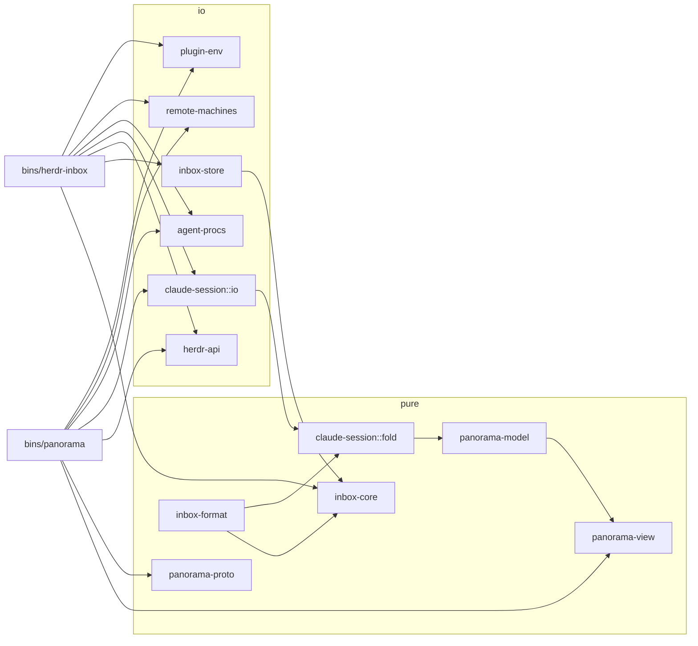

# Rust rewrite of herdr-panorama and herdr-inbox: plan

Status: **draft for the operator's decision**. Nothing is built yet. This plan covers both plugins:

- herdr-panorama (`~/Code/herdr-panorama`, main `dfcbced`);
- herdr-inbox (`~/Code/herdr-inbox`, main `3796ef8`), with its Claude Code plugin and the
  `herdr-inbox-ui` mod.

It answers LeaveMyYard/herdr-panorama#22 and LeaveMyYard/herdr-inbox#36 ("really refactor the
code … it is just a mess of functions without any structure and docstrings. And I consider
rewriting to rust in order to make it faster"), and the follow-up: "Right now I hate how the code
is structured."

Every number in this document was measured on this workstation on 2026-10-17, unless it is marked
*estimate*. Appendix A says how each was measured. Line references are to the two main commits
above.

## Summary

- **Recommendation: rewrite both plugins in Rust as one Cargo workspace with shared crates, using a
  strangler migration rather than a big bang.** Each component is replaced behind the existing
  contracts (the inbox's SQLite database, the panorama core↔panel socket protocol, the hook
  payloads, the MCP tool schemas), and you keep a working setup the whole way.
- **The structural problem is real and measurable.**
  - Three files are over 1,900 lines.
  - Two classes are over 790 lines (`SwarmApp`: 86 methods; `InboxApp`: 55 methods).
  - 56% of functions have no docstring in both repos.
  - At least 11 pieces of logic are duplicated between the repos, and some copies already disagree
    (§1.3).
- **On speed, Rust helps a lot in some places and not at all in others.**
  - Large wins: hook latency (125 ms → about 3 ms per tool batch, measured on a spike), memory
    (about 900 MB PSS across 31 processes today; an estimated 100–150 MB after), animation CPU, and
    popup start time.
  - **No visible change** to switching chats: the pane-move frame and the tab switch are drawn by
    herdr (§6).
- **The first win can ship early.** The inbox hooks and the rewake watcher are small, already
  isolated, and the most frequently started processes. Porting them first proves the shared crates
  and the distribution path at the lowest risk.
- **Effort, rough:** about 44–67 agent-days of building plus review rounds over 9 phases. That is
  about 9–13 calendar weeks on one track, or less with the two plugin tracks running in parallel
  after phase 1 (§7.3).

### Decisions this plan needs from you

| # | Decision | Recommended | Asked as |
|---|---|---|---|
| D1 | One repo or two | One new monorepo with both plugins in subdirectories (§2.1) | Q168 (open) |
| D2 | Python feature freeze while a component is ported | Freeze per component, bugfixes only (§5.5) | Q169 (open) |
| D3 | The Python refactor from #22/#36 Part 1 | Skip it. Keep only the parity harness (§5.2) | Q170 (open) |
| D4 | Migration style | Strangler, inbox hooks first (§5.1) | this PR |
| D5 | UI toolkit | ratatui 0.30 + crossterm 0.29 (§2.6) | this PR |
| D6 | One continuation rule for both plugins | panorama's rule, pinned by captured fixtures (§1.3, item 3) | this PR |

Q168–Q170 were filed through herdr-inbox and are still open. This document follows the
recommended default for each of them until you answer.

---

## 1. Current state

### 1.1 Size

| | herdr-panorama | herdr-inbox |
|---|---|---|
| Python source (`src/`) | 10,299 lines, 30 files | 8,146 lines, 20 files, plus `hooks/run.py` (92) |
| Functions / without a docstring | 669 / **373 (56%)** | 523 / **291 (56%)** |
| Tests (`def test_`) / collected | 519 / 953 | 507 / 552 |
| Test code | 10,119 lines | 9,016 lines |
| Full test run | 92 s (1 failure here) | 141 s (2 failures here) |
| Non-Python parts | `docs/design/*.js` (the design's own renderers, used to capture goldens) | `plugins/herdr-inbox-ui` (TSX mod, 176 lines plus tests) |

About the failures: `test_follow.py::test_no_follow_while[form]` failed in panorama, and two
`test_venvs.py` tests failed in inbox, on this workstation's checkouts of main. I did not look into
them because they are outside this plan. They are listed only so that "all green" is not assumed.

**Largest files:**

| File | Lines | Functions | What is mixed in it |
|---|---|---|---|
| panorama `render.py` | 2,119 | 148 | the 2a graph, the narrow layout, the 9e docked panel, tiles, the animation (`Anim`, pulses, sweeps), the palettes, hit targets, the legend, and the key hints |
| inbox `tui.py` | 1,961 | 166 | the popup app, group list, question view, review, failed and alert views, input and arming, the polling loop, and deep links |
| panorama `tui.py` | 1,460 | 119 | the app shell, the Textual private-API patch, the grid widget, input and arming, mouse hit-testing, cockpit follow, dock workers, driving the panel manager, the new-agent form, opening the inbox, and the home tab |
| inbox `store.py` | 1,087 | 75 | schema and migrations, questions, delivery claims, sessions, hook bookkeeping, the remote mirror and outbox, and reconciliation |
| inbox `service.py` | 868 | 46 | the ask path, delivery, relocating answers, continuations, hook verification, tab markers, and background threads |
| inbox `remote.py` | 846 | 55 | ssh, install and upgrade on remote machines, pull, and flush |
| panorama `scan/session.py` | 781 | 33 | tailing, folding records, and the status rules |

**Largest classes and functions:**

| Item | Size |
|---|---|
| panorama `tui.py:219 SwarmApp` | 1,109 lines, 86 methods |
| inbox `tui.py:1166 InboxApp` | 796 lines, 55 methods |
| inbox `store.py:428 Store` | 657 lines, 63 methods |
| panorama `scan/session.py:144 Session` | 548 lines, 28 methods |
| panorama `panels.py:92 Manager` / `collect.py:67 Collector` / `core.py:108 Core` | 301 / 296 / 276 lines |
| inbox `cli.py:33 main` | 192 lines (one function) |
| inbox `service.py:388 deliver_batch` | 180 lines, about 20 early-exit branches |
| panorama `render.py:1483 _wide` / `:1615 _narrow` | 130 / 108 lines |

### 1.2 What is wrong with the structure

**herdr-panorama**

1. **The UI class is the program.** `SwarmApp` owns rendering, input, the arming rules, mouse
   targets, the cockpit dock and follow workers, panel-manager passes, the core socket's callbacks
   (`_open_key`, `_owned_pane`), the inbox deep link, and the new-agent popup.
   - Thread hand-offs into it are delicate enough that the design doc has to explain them.
   - Example: the early dock report must use `post_message`, not `call_from_thread`, or it
     deadlocks under the home lock (DESIGN.md "No waiting across the lock").
2. **One rendering module for every view.** `render.py` has no module boundary between the 2a
   graph, the narrow layout, and the docked panel, which share helpers through module-level
   globals (`ST`, `PB`, `LINE`, `FAINT`, `HOVER`, …).
   - It already draws into its own cell grid (`render.Screen`, `render.py:111`). Textual is used
     only to put that grid on the terminal.
3. **The collector mixes four jobs.** `Collector` (`collect.py:67`) does herdr snapshot
   interpretation, session-continuation following, process liveness (`bgproc`), thread grouping,
   inbox matching, and tab-label rules, all in one pass.
4. **A private Textual API is patched.**
   - `tui.py:48-94` replaces `textual._compositor.ChopsUpdate.render_segments` so that a pulsing
     cell does not re-send the whole line.
   - It is pinned to Textual `>=8.2,<8.3` (`pyproject.toml`), while herdr-inbox takes
     `textual>=3.0`.
   - It has a fallback, but every Textual upgrade is a risk, and the patch exists only because the
     toolkit does not diff cells.
5. **Two IO styles for one server.** Calls go through the CLI (`subprocess`, `herdr.py:56-92`),
   except where the CLI lacks a method; those go through a hand-written socket client
   (`herdr.py:150-196`, `events` at `:423`). That gives two error models: `(None, err)` tuples and
   `NoReply(str)`.

**herdr-inbox**

1. **Delivery state is stored as a string prefix.**
   - `questions.delivery_error` holds `sending:<time>:<token>` (the CAS claim), `pending: …`,
     `pending: requeued: …`, `agent gone: …`, and real errors (`store.py:613-618`, `PENDING`,
     `AGENT_GONE`, `REQUEUED`).
   - The state machine is implicit, and it is spread over `service.deliver_batch`, `hook.deliver`,
     `rewake.run`, and `worker.tick`.
2. **One 180-line function is the delivery policy.**
   - `deliver_batch` decides, for each pane: no pane, agent gone, relocated, conversation changed,
     blocked, idle and watched, working and hooked, requeued, busy grace, busy cap, focused,
     background panel, already landed, composer draft or unknown, typed, and verify.
   - Each rule has a reason (the comments cite live incidents), but none of them can be tested
     without the whole function and a fake herdr.
3. **`Store` holds every table.** Questions, groups, sessions, hooks, alerts, blocked panes, the
   remote mirror, the outbox, and applied requests are all one class.
4. **Most of the work is Python distribution.**
   - Per-version venvs and their cleanup (`venvs.py`, 184 lines).
   - A stdlib-only import chain for hooks, plus a uv fallback for an old `python3`
     (`hooks/run.py`).
   - Exit-code laundering so that uv's own exit 2 never reaches Claude Code (`run.py:1-11`).
   - Worker handover between versions on disk (`worker.py:233-275`).
5. **Process-global caches and state** live in module dicts: `service._unreadable_since`,
   `_revive_checked`, `transcript._found`, `_follow_cache`, `remote._machines_cache`, and the
   config `_cache` (16 module-level mutable singletons across both repos).

### 1.3 Logic duplicated between the repos

| # | Logic | herdr-panorama | herdr-inbox | Already diverged? |
|---|---|---|---|---|
| 1 | herdr client: `clean`, `run_raw`, `call`, `invocation_pane`, `plugin_config_dir`, `rename_tab`, `focus_agent`, `prompt_agent` | `herdr.py:28-125, 274, 305` | `herdr.py:27-166` | Copied almost line for line. Timeouts and error handling are the same. |
| 2 | Transcript discovery | `scan/discovery.py:23-60` (cwd project dir first, then a scan) | `transcript.py:24-56` (glob, LRU cache) | Different search order and caching |
| 3 | `continued-in` following | `scan/session.py:293-307, 381-393`; `collect.py:94-124` | `transcript.py:64-130`; `store.record_continuation`; `service.adopt_continuations` | **Yes.** panorama treats the old session as resumed only after a later `user`/`assistant` record. inbox stops following after *any* record outside a 7-type bookkeeping list, so a new kind of bookkeeping record from Claude Code silently breaks the inbox's following. |
| 4 | Session-id validation | `discovery.py:20`, `machines.py:46` (UUID, any case) | `transcript.py:56` (`[A-Za-z0-9_-]{1,128}`), `:69` (UUID, lowercase only) | **Yes.** Four regexes with three meanings |
| 5 | "Is this process Claude Code?" | `hooks.py:104 is_claude` (native, versioned binary, node + package) | `proc.py:51,70` (`comm == "claude"` only) | **Yes.** The inbox's nested-Claude check misses versioned and node installs. |
| 6 | Config loading (TOML in the plugin config dir, mtime cache) | `config.py` | `tabs.py:52-63`, `radar.py:218-253` | Separate parsers and caches |
| 7 | Remote machines (`herdr machine list --json`, ssh options, ControlMaster) | `machines.py:84,126` | `remote.py:40-52, 329-330` | Two ssh control masters to the same host (`panorama-ssh-…` and `hinbox-…` are both running now) |
| 8 | Inbox database path and schema | `inbox.py:26-52` reads `questions` directly | `store.py` owns it | panorama depends on the inbox's private schema |
| 9 | Opening plugin panes, deep link to the inbox | `herdr.py:127-140`, `inbox_link.py` (spawns `uv run … inbox open`) | `herdr.py:293-305`, `deeplink.py` | panorama shells into the other plugin's venv |
| 10 | The `[inbox] Q7 answered — …` format | `scan/wire.py:45-46` (receipts) | `transcript.py:200-250`, `service.delivery_text` | A **third** parser exists in TypeScript (`register.tsx parseAnswers`) |
| 11 | Text sanitising for herdr, terminals and MCP | `herdr.clean`, `mcp_server._INVISIBLE` | `herdr.clean`, `store.clean_title` | Partly |

Rows 3–5 are the ones that matter. Duplicated logic has already turned into different behaviour.

### 1.4 Test pain

- **Tests are tied to the Python internals.**
  - There are 312 `monkeypatch.setattr` calls (145 in panorama, 167 in inbox), and 30 test files
    reach private names.
  - The fake herdr is a CLI stub that records argv (`tests/conftest.py`, `FakeHerdr`), so tests
    assert on CLI argument lists, not on what was asked of herdr.
  - As a result, the suites cannot run against another implementation as they are. They are a
    specification, not a harness (§5.2).
- **Timing-based tests are the slow ones.** The slowest are 3–6 s each (arming, settle waits,
  real timing), and the full runs take 92 s and 141 s.
- **The strong assets are language-neutral already.** The design goldens (`tests/fixtures/design_*.json`)
  are captured from the design's own JS renderers as runs of `[text, fg, bg, bold]` per row. The
  transcript templates (`templates.json`) and the herdr snapshot are captured, not invented. The
  replay oracle (`tools/replay_oracle.py`) scores the scanner against what agents actually did
  next. All of these carry over to Rust as they are.

---

## 2. Target architecture

### 2.1 One repo or two

| | One monorepo (recommended) | Two repos and shared crates |
|---|---|---|
| Shared code | Path dependencies, so one change means one PR and one CI run | Git or crates.io dependency; every shared fix needs a version bump in both repos |
| herdr install | `herdr plugin install LeaveMyYard/<repo>/plugins/panorama` (herdr accepts `owner/repo/subdir`) | Same commands as today |
| herdr.dev/plugins | One card listing both manifests ("one card per repository … lists each valid manifest") | Two cards |
| Claude marketplace | One `marketplace.json` with 3 plugins (inbox, inbox-ui, panorama) | Same as today |
| Cost of moving | The install source changes. Both repos have 2 stars and 0 forks, and your setup uses linked checkouts, so in practice it is a relink | None |

**Recommendation: one new repository** (name open in Q168; e.g. `herdr-swarm`).

- Keep the plugin ids `leavemyyard.herdr-panorama` and `leavemyyard.herdr-inbox` unchanged. herdr
  keys config and state directories by plugin id, so `HERDR_PLUGIN_CONFIG_DIR` and
  `HERDR_PLUGIN_STATE_DIR` survive the move.
- The old repos stay as they are until cutover. They then get a final README pointer and are
  archived.

### 2.2 Workspace layout

```
herdr-swarm/                         (name: Q168)
  Cargo.toml                         [workspace], one Cargo.lock, edition 2024, MSRV pinned
  crates/
    herdr-api/                       herdr socket client, typed ids and events, fake server (feature "fake")
    claude-session/                  transcripts: discovery, tailing, lenient wire, continuation, session fold
    agent-procs/                     process tree: is-Claude, owning Claude, nested, start token, liveness
    plugin-env/                      HERDR_PLUGIN_* env, config.toml with reload, durations, state dirs, flock, private socket dirs
    remote-machines/                 herdr machine list, one shared ssh mux, rsync mirror
    tui-kit/                         terminal setup and restore, identity cursors, arming, click targets, herdr theme, colour mixing
    inbox-format/                    the `[inbox] …` delivery text: one encoder and parser (golden file shared with the TS mod)
    panorama-model/                  pure: Swarm/Orchestrator/Thread/Phase/Agent, status codes, thread grouping, unseen
    panorama-view/                   pure: layout and render into a ratatui Buffer: graph2a, narrow, dock9e, tiles, legend, anim
    panorama-proto/                  core↔panel protocol v1.x types (serde), framing, limits
    inbox-core/                      pure: Question/Group/Alert, DeliveryState, delivery policy `decide()`, dedup
    inbox-store/                     rusqlite: the same schema and migrations, CAS claims, remote mirror and outbox
  bins/
    panorama/                        one binary: tui | panel | core | new-agent | open | home | snapshot | hook | mcp | emit
    herdr-inbox/                     one binary: tui | mcp | hook | worker | open | deliver | verify | export | apply | remote …
  plugins/
    panorama/   herdr-plugin.toml, .claude-plugin/, hooks/hooks.json, scripts/
    inbox/      herdr-plugin.toml, .claude-plugin/, hooks/hooks.json, scripts/, skills/
    inbox-ui/   the TSX mod (unchanged, §3)
  fixtures/                          captured goldens and protocol recordings (§5.2), shared by every crate's tests
  tools/                             fixture capture (kept in Python or JS where the source is Python or JS)
```

Each plugin gets **one binary**, with subcommands that keep today's CLI names. The `inbox open`,
`inbox export`, and `inbox apply` commands are contracts that other plugins and remote machines
call. A hook subcommand inside the full binary starts in about 3 ms (§6), so a separate hook binary
is not needed.

### 2.3 Crates: responsibilities, main types and boundaries

The rule throughout: **pure crates take data and the current time, and return data.** They do no
IO, start no threads and read no environment. IO lives in the `herdr-api`, `claude-session::io`,
`agent-procs`, `inbox-store`, `remote-machines` and `bins/*` crates.



**`herdr-api`** is the only code that talks to herdr. It uses the socket only; the CLI subprocess is
gone.

- Every method both plugins use is a raw socket method: `session.snapshot`, `pane.*`, `agent.*`,
  `tab.*`, `layout.*`, `plugin.pane.*`, `events.subscribe`, `notification.show`, and
  `pane.report_metadata` (socket-api.mdx, herdr 0.9.5).
- A socket `session.snapshot` takes 0.6 ms, against 2.3 ms for `herdr api snapshot` through the CLI.

```rust
pub struct PaneId(String); pub struct TabId(String); pub struct WorkspaceId(String);
pub struct ServerId(PathBuf);                 // the socket path; one inbox worker per server

pub enum HerdrError {
    NotRunning,                               // no socket: nothing was sent
    Refused { code: String, message: String },// herdr answered with an error
    NoReply,                                  // sent, unanswered: herdr may have done it (panorama's NoReply)
    Garbled,
}
pub struct Herdr { socket: PathBuf, timeout: Duration }
impl Herdr {
    pub async fn snapshot(&self) -> Result<Snapshot, HerdrError>;
    pub async fn agent(&self, pane: &PaneId) -> Result<Option<AgentInfo>, HerdrError>;
    pub async fn prompt(&self, pane: &PaneId, text: &Sanitized) -> Result<(), HerdrError>;
    pub async fn read_pane(&self, pane: &PaneId, lines: u16, ansi: bool) -> Result<String, HerdrError>;
    pub async fn process_info(&self, pane: &PaneId) -> Result<Option<Vec<ForegroundProc>>, HerdrError>;
    pub fn events(&self, kinds: &[EventKind]) -> impl Stream<Item = HerdrEvent>; // reconnecting, with Connected/Lost markers
    // … one typed method per raw method used today
}
pub struct Sanitized(String);                 // the only way to build a prompt or label: `clean()` is its constructor
pub struct AgentInfo { pub pane: PaneId, pub tab: TabId, pub kind: AgentKind,
                       pub status: AgentStatus, pub session: Option<SessionId>, pub focused: bool }
pub enum AgentStatus { Idle, Working, Blocked, Done, Unknown }
```

- `Sanitized` makes "every argument goes through `clean()`" a type rule rather than a convention.
- The `fake` feature provides `FakeHerdr`: a Unix socket server that answers from a scripted state
  and records every request as `(method, params)`. All integration tests use it in place of the
  argv-recording CLI stub.

**`claude-session`** is one implementation of everything about Claude Code's files. It replaces
`scan/` and `collect.py`'s continuation code in panorama, and `transcript.py` in the inbox.

```rust
pub struct SessionId(Uuid);                   // the one validator (row 4 of §1.3): canonical UUID, any case in, lowercase out
pub struct ProjectsRoot(PathBuf);             // ${CLAUDE_CONFIG_DIR:-~/.claude}/projects
pub enum Tail { Missing, NoChange, Reset, Lines(Vec<Bytes>) }   // tail.py, with the same 8 MB partial cap
pub struct Tailer { offset: u64, partial: Vec<u8>, identity: Option<(u64, u64)> }

pub enum Record<'a> {                         // lenient: unknown kinds become Other, a broken line is None
    Assistant { ts: Option<Ts>, model: Option<&'a str>, blocks: Vec<Block<'a>> },
    User { ts: Option<Ts>, content: Content<'a>, tool_use_result: Option<ToolUseResult<'a>> },
    QueueEnqueue { content: &'a str }, Attachment(Attachment<'a>),
    ContinuedIn { from: SessionId, to: SessionId, ts: Option<Ts> },
    Title(TitleKind, &'a str), Bookkeeping(&'a str), Other,
}
pub struct Continuation;                      // ONE rule (D6), used by both plugins
impl Continuation { pub fn chain(&self, start: SessionId, files: &impl TranscriptFiles) -> Vec<SessionId>; }

pub struct Session { /* the keyed stores of scan/session.py: spawns, acks, notices, resumes, journals, bg … */ }
impl Session {
    pub fn apply(&mut self, owner: Owner, rec: &Record, ts: Option<Ts>);   // the fold: pure
    pub fn status_of(&self, agent: &AgentId, now: Ts, procs: &dyn Liveness) -> AgentStatus; // the rules, pure
}
```

- **D6, the continuation rule.** Use panorama's rule: a continuation is cleared only by a later
  `user` or `assistant` record. The inbox's rule ("anything not on the bookkeeping list") breaks
  the first time Claude Code adds a new bookkeeping record; `mode` already had to be added to that
  list. Fixtures captured from real continued and resumed sessions pin the rule.
- `status_of` takes the clock and a `Liveness` trait (process checks) as arguments. The status
  rules described in the `scan/session.py:1-44` docstring become table-driven tests.
- The 64 KB tail summary (`summarize_tail`) and the marker prefilter (`wire.MARKERS`) are ported as
  they are. A Rust spike of the prefilter plus parse is 6× faster (§6).

**`inbox-core`** holds the delivery policy as a pure function. It replaces the branch ladder in
`service.py:388-567`.

```rust
pub enum DeliveryState {                      // what delivery_error encodes today, now named
    Unattempted,
    Claimed { at: Ts, token: ClaimToken },    // "sending:<at>:<token>"
    Pending(PendingReason),                   // "pending: …" (Blocked, Busy{since}, WatcherWakes, HookCarries, Requeued, Composer(Draft|Unknown), OperatorInPane, Panel, …)
    AgentGone(String),                        // "agent gone: …"
    Failed(String),
    Delivered { verified: bool, acknowledged: bool },
}
pub struct Observation {                      // everything the IO side looked up for one pane
    pub agent: Option<LiveAgent>, pub watcher_alive: bool, pub hook_live: bool,
    pub focused: bool, pub panel_focused: bool, pub composer: ComposerState,
    pub landed: BTreeMap<QuestionId, LandedKinds>, pub elsewhere: Option<(PaneId, TabId)>,
}
pub enum Action {
    Record(QuestionId, Outcome), SetPending(QuestionId, PendingReason), MoveTo(QuestionId, PaneId),
    Type { pane: PaneId, text: Sanitized, batch: Vec<QuestionId>, verify: VerifyPlan },
    Notify { title: String, body: String },
}
pub fn decide(qs: &[Question], obs: &Observation, mode: Mode /* first | retry | force */, now: Ts) -> Vec<Action>;
```

- `decide` never types and never reads. The worker, the hook and the rewake watcher each gather an
  `Observation`, call `decide`, and carry out the actions.
- **The CAS claim protocol stays exactly as it is, byte for byte** (`store.py:606-625`), because
  Python and Rust processes share one database during the migration (§5.4).

**`inbox-store`** holds the same SQL.

- The `SCHEMA` text, `TABLE_ADDED_COLUMNS`, the versioned read view (`questions_v6`), and the
  `user_version` stamp carry over unchanged.
- Rust keeps today's rules:
  - columns are never dropped;
  - new fields go to `question_ext` or new tables, never `questions` (0.1.x reads `SELECT *`);
  - an older view is never dropped while an older release may still read it.
- The store is split into modules by table group: `questions`, `claims`, `sessions`, `alerts`,
  `remote`, `migrate`.

**`panorama-view`** renders into `ratatui::buffer::Buffer`, which is the counterpart of
`render.Screen`.

- One module per view:
  - `graph2a/`: orchestrator, thread and agent columns, links, cards;
  - `narrow/`;
  - `dock9e/`: dock rows and tiles;
  - `chrome/`: header, legend, key hints;
  - `anim/`: `Anim` cells, spinner, clock, sweep, blink, pulse, `restyle`.
- `render(&Swarm, &View, Rect) -> Frame { buffer, targets: HitMap, anims: Vec<AnimCell> }` stays
  pure.
- The `restyle == full render` property test (`tests/test_smooth.py`) and the cell-for-cell design
  goldens carry over unchanged.

**`panorama-proto`**: protocol v1.1 is already language-neutral (`docs/protocol/panel-v1.md`). Rust
serde types plus a JSON schema are generated from them. The limits (4 MiB line, outbox of 4,
hello within 5 s, 64 viewers) become constants with tests.

### 2.4 The processes after the rewrite

| Process | Today | After |
|---|---|---|
| panorama home view and core | `uv` → Python, Textual | `panorama tui` (an actor, below) |
| per-tab panel (×N) | Python, Textual | `panorama panel` (render only, its own input) |
| panorama hooks | `python3 -I hooks.py` | `panorama hook <event>` |
| report_thread MCP (per session) | `uv` → Python, `mcp` SDK | `panorama mcp` |
| inbox MCP (per session) | `uv` → Python, `mcp` SDK | `herdr-inbox mcp` |
| inbox hooks (every tool batch and turn end) | `python3 -I run.py` | `herdr-inbox hook <event>` |
| rewake watcher (per idle session) | Python, polling the database every 2 s | `herdr-inbox hook rewake-watch` |
| delivery worker (per herdr server) | Python | `herdr-inbox worker` |
| inbox popup | `uv` → Python, Textual | `herdr-inbox tui` |

### 2.5 Concurrency model

- **Interactive processes** (`panorama tui`, `panorama panel`, `herdr-inbox tui`, `herdr-inbox
  worker`, the MCP servers) use **tokio** with one actor that owns the state.
  - Every event source is a task that sends an `Event` into one `mpsc` channel: terminal input
    (crossterm `EventStream`), the 20 fps colour tick, the 250 ms frame, the 1.5 s collect, herdr
    `events.subscribe`, viewer connections, remote watchers, and the results of dock and panel
    actions.
  - The actor alone mutates `AppState` and draws.
  - Collects and transcript reads run in `spawn_blocking`, because file IO is blocking; zoetrope
    reached the same conclusion.
  - This removes by construction the whole lock-and-thread class the design docs fight today
    (home lock waits, `call_from_thread` deadlocks, `exclusive` workers that keep running).
  - The **arming rules** become plain state checked by the actor before an action runs: no key
    acts within `ARM_SECONDS` of a selection change.
- **Why tokio rather than threads.** The MCP SDK (rmcp) is tokio-based. The core already serves up
  to 64 socket viewers alongside a herdr event stream and timers, and an async select loop
  expresses that directly. The binaries use a `current_thread` runtime plus the blocking pool:
  nothing here needs CPU parallelism.
- **Hooks use no runtime at all.** They are synchronous `std` plus `rusqlite`, return early, and are
  measured at 3.4 ms (§6). The rewake watcher is also a plain loop: `sleep`, then a read-only
  query, then a herdr check.
- **Cross-process exclusion stays where it is:** `flock` files, the CAS claims in SQLite, and the
  socket locks. Rust uses the same lock paths (`worker-<sha1(server)[:12]>.lock`,
  `rewake/<session>.lock`, `core-<session>.lock`), so a Python process and a Rust process exclude
  each other during the migration.

### 2.6 Rendering toolkit

What panorama needs:

- 20 fps colour animation over a mostly static screen;
- 24-bit colour on every cell;
- braille spinners (single-width) and box drawing;
- mouse hover, which needs any-motion tracking (`?1003h`) plus SGR mouse;
- focus-in and focus-out reports (the docked panel's focus look);
- precise cell control (it already lays out cells itself);
- popups (herdr draws these as separate panes, so in-app overlays only for confirm dialogs).

The inbox popup also needs a text input (free answers and notes).

| Option | Fit |
|---|---|
| **ratatui 0.30 + crossterm 0.29** (recommended) | Its `Buffer` is the counterpart of `render.Screen`. The diffing `Terminal` sends only changed cells, which is exactly what the Textual patch hacks in. crossterm enables any-motion mouse plus SGR (`EnableMouseCapture`) and focus reports (`EnableFocusChange`). Widths come from `unicode-width`. Spike: a 160×45 truecolour grid with 61 cells animating cost **0.12 ms per tick and 2.6 KB of output, at 3.7 MB RSS** (§6). zoetrope, the tool the scanner is ported from, is built on the same stack. Text input: `ratatui-textarea` 0.9 or a small hand-written line editor. |
| termwiz (wezterm's) | Has a good surface diff and input parsing, but a smaller ecosystem and heavier dependencies. No advantage here. |
| crossterm alone, with our own diff | Possible, since panorama owns its layout, but it re-implements ratatui's buffer and diff for nothing. |
| cursive, or retained-mode widget toolkits | Too much layout policy. Fighting the toolkit is the Textual problem again. |
| notcurses | A C dependency, so static musl builds get harder. |

---

## 3. What stays non-Rust, and why

| Piece | Language | Why |
|---|---|---|
| `herdr-inbox-ui` mod (`register.tsx`) | TypeScript | Claude Code mods run inside Claude Code's JS engine, so there is no alternative. It keeps its tests. Its `parseAnswers` is pinned to the same `fixtures/inbox-format/*.txt` goldens that `inbox-format` uses, so the 3 parsers become 1 spec with 2 implementations. |
| herdr and Claude manifests (`herdr-plugin.toml`, `plugin.json`, `hooks.json`, `marketplace.json`) | TOML and JSON | Contracts with the hosts |
| Launcher shims (`scripts/launch`) | POSIX sh, about 30 lines | Resolve the binary (§4). Keep the hook's always-exit-0 policy and the exit 3 → 2 mapping of `rewake-watch`. Hooks need a stable path that exists before the binary does. |
| SessionStart rules fallback | plain text file printed by the shim | If the binary is missing, sessions still get the inbox rules (today's `SESSION_RULES`) |
| Design references and golden capture (`docs/design/*.js`, `capture_design.py`) | JS and Python, dev only | They *are* the design and the capture tools. Rewriting them would make the goldens a translation, not a capture. |
| Transcript and snapshot capture (`tests/fixtures/capture.py`) | Python, dev only | Same reason. A port to Rust is optional later. |
| MCP servers | **Rust** (rmcp 3.5) | 8 sessions run 8 inbox servers now (282 MB PSS plus 74 MB of `uv` parents, 0.5–0.6 s import each, §6). The tool surface is small (6 inbox tools, 1 panorama tool). Pin rmcp and keep it behind a thin adapter. If rmcp churns, a hand-written stdio JSON-RPC for tools only is about 300 lines. The tool names, descriptions and JSON schemas are captured from the Python servers as goldens, because agent behaviour depends on that text. |

---

## 4. Distribution

**What the hosts offer** (checked in herdr 0.9.5 `plugins.mdx` and `marketplace.mdx`, and the
Claude Code plugin docs):

- **herdr**
  - `plugin install owner/repo[/subdir]` clones the repo, then runs the `[[build]]` commands in the
    new install directory. They run as the user, without the runtime environment.
  - Builds can be split per platform (`platforms = ["linux"]` on an item), but not per CPU.
  - There is no download or binary hook. The build command is the hook.
  - Updates install into a new directory, and running panes keep their old files.
  - `plugin link` runs no build.
- **Claude Code**
  - There is no install or build step. A top-level `bin/` is on PATH only for the Bash tool, and
    org sync rejects a top-level `bin/`.
  - `${CLAUDE_PLUGIN_ROOT}` changes with every version. `${CLAUDE_PLUGIN_DATA}` is per plugin and
    kept across updates.
  - Exit 2 from SessionStart or SubagentStart only shows an error to the user; from Stop or
    PostToolBatch it blocks.
- **Prior art.** zoetrope ships a herdr plugin whose `[[build]]` (`herdr/ensure-zoe.sh`) checks for
  its binary and installs it with Homebrew or cargo. Its releases carry musl and darwin tarballs
  with checksums.

**Plan:**

1. **Releases.** CI builds the targets `x86_64-unknown-linux-musl`, `aarch64-unknown-linux-musl`,
   `x86_64-apple-darwin` and `aarch64-apple-darwin`.
   - Static musl Linux builds; `rusqlite` with `bundled`, so there is no system sqlite dependency.
   - One tarball per plugin and target, plus a `SHA256SUMS` file, attached to a tag per plugin
     (`panorama-v0.2.0`, `inbox-v0.11.0`).
   - Use cargo-dist (0.32) or a plain matrix workflow, whichever is less config. cargo-dist's
     installer scripts are not used, because the herdr build step is our installer.
2. **herdr side.** `[[build]] command = ["sh", "scripts/install-bin.sh"]`:
   - read the version from the manifest, map `uname -s`/`-m` to a target, download the tarball for
     that tag with `curl`;
   - **verify it against checksums committed in the repo at that tag**, so a replaced release asset
     fails the install;
   - unpack it to `./bin/`;
   - fall back to `cargo build --release --locked` when there is no asset and `cargo` exists;
     otherwise fail with a clear message, as zoetrope does.
   - Runtime commands become `sh -c 'exec "$HERDR_PLUGIN_ROOT/bin/panorama" tui'`. A pane's cwd is
     not documented to be the plugin dir, which is the same reason for today's wrappers.
   - `uv`, the venvs and the `uv` parent processes all go away.
3. **Claude side.** `hooks.json` and `mcpServers` call `${CLAUDE_PLUGIN_ROOT}/scripts/launch`. It
   uses the first of:
   - `${CLAUDE_PLUGIN_DATA}/bin/<name>-<version>`;
   - the herdr-installed binary, found once and recorded by the herdr build step at
     `$XDG_STATE_HOME/<plugin>/bin/<name>-<version>`, a stable path outside any install dir;
   - for the **MCP server only**, a download into `CLAUDE_PLUGIN_DATA` with the same checksum check.

   **Hooks never download.** When a hook finds no binary, it exits 0, and SessionStart prints the
   static rules. A linked dev checkout resolves `target/release/` first.
4. **Updates.** `herdr plugin update` re-runs the build, so a new binary lands in a new directory.
   The inbox worker's version handover (`worker.py:233-275`) is kept: the Rust worker hands over to
   the binary of the newer installed version.
5. **Listing.** herdr.dev shows the repo's primary language (Rust) and one card with both plugins.
   `platforms` stays `["linux", "macos"]`. Windows is out of scope: the plugins use flock, Unix
   sockets and `/proc`.

---

## 5. Migration

### 5.1 Strangler, not big bang

A big bang means about 18k lines of Python rewritten before you could run anything, against a
moving target. Python gains features weekly: PR #43 landed this week.

A strangler works because the seams already exist:

| Seam | Contract that Python and Rust both speak |
|---|---|
| inbox hooks and rewake watcher ↔ everything else | the SQLite database: schema, CAS claims, `sessions` rows, lock files |
| inbox MCP server ↔ worker and popup | the same database |
| panorama panel viewer ↔ core | protocol v1.1 over the core socket |
| panorama hooks ↔ scanner | `hooks/<session>.jsonl` (v1 records) |
| report_thread ↔ scanner | `events/<session>.jsonl` (the explicit channel) |
| inbox ↔ remote machines | `inbox export` and `inbox apply` JSON (`docs/REMOTE.md`) |
| panorama ↔ inbox | read-only `questions` columns, and `inbox open --question/--pane` |

Each phase replaces one side of one seam and leaves the other side in Python. A component switches
by changing one command line in a manifest. Rolling back means changing it back.

### 5.2 Proving parity

Nothing is invented: every golden is captured from the running Python code, the design's JS, or
real herdr and Claude Code runs (the rule from `tests/fixtures/README.md`).

1. **Design goldens** (`design_*.json`, already captured): `panorama-view` must reproduce them cell
   for cell, frames and fractional frames included.
2. **App-screen goldens.** Run the Python apps headless (Textual `run_test`) through the test
   scenarios, and dump each screen as `[text, fg, bg, bold]` runs. This is new, and it is the inbox
   popup's spec, since the inbox has no JS design goldens.
3. **Model goldens.** `panorama snapshot --json` over every `tests/scenario.py` scenario, at fixed
   `now` values. `claude-session` plus `panorama-model` must emit the same JSON.
4. **Differential replay.** Run the Python and Rust scanners side by side over your real transcripts
   at past instants (the replay oracle's method). Only counts and disagreements are printed, never
   content. Exit criterion: zero status or parent disagreements.
5. **Delivery decision table.** A test-only trace hook in Python's `deliver_batch` records
   `(inputs, outcome)` for every path the 552 inbox tests drive, and `inbox-core::decide` must
   reproduce the table. This captures the policy as it is, including the rules that came from
   incidents.
6. **Protocol recordings.**
   - herdr socket request and reply transcripts, recorded on an **isolated** herdr (`herdr
     --session` with its own HOME, as `tools/latency_bench.py` does). These seed `FakeHerdr`.
   - Hook payloads and MCP `tools/list` captured from a real Claude Code run.
   - Composer ANSI screens: the existing `tests/fixtures/composer/*.ansi`.
7. **A test ledger.** A CSV maps each of the 1,505 collected Python tests to its Rust test, or to
   "retired" with a reason (for example, the venv tests). A phase is done when its rows are filled.

On D3: the Python Part 1 refactor of #22/#36 would restructure code that this plan then replaces.
Only items 2, 3 and 5 touch the Python repos, and only in test code.

### 5.3 Phases

| Phase | Builds | Milestone and exit criteria | Rough effort |
|---|---|---|---|
| **P0 Harness** | Capture items 2, 3, 5 and 6 above. Create the monorepo, CI (Linux and macOS, musl), and the ledger. | Goldens committed. CI green on an empty workspace. | 3–5 d |
| **P1 Shared crates** | `herdr-api` (with `FakeHerdr`), `claude-session`, `agent-procs`, `plugin-env`, `inbox-format` | Scanner model goldens match. Differential replay shows 0 disagreements on your transcripts. `inbox-format` goldens match in Rust and in the TS mod. | 5–7 d |
| **P2 Inbox hooks and rewake watcher** | `herdr-inbox hook …`, `inbox-store` (claims and sessions only), `inbox-core::decide` (hook and watcher paths) | Ledger rows for `test_hook*`, `test_rewake`, `test_verified_delivery`, and the hook paths of `test_session_continuation`. One week of your daily use with Python worker, MCP and popup, and Rust hooks: no double delivery, no lost delivery (every answer verified in the transcript, checked with an audit query), and no exit-2 leak. | 3–5 d |
| **P3 Panorama panel viewer** | `panorama panel` on protocol 1.1, `panorama-view::dock9e` | `design_9` and `design_10` goldens byte-identical. The isolated-herdr panel checks in DESIGN.md "As built" pass. 8 panels at under 5 MB each. | 3–5 d |
| **P4 Panorama core and home view** | collector, core socket, panel manager, cockpit and home, `graph2a` and `narrow`, new-agent form, mouse, arming, hooks, report_thread MCP | All design and app-screen goldens. The safety tests (identity cursors, arming, follow guards, never closing panes) are ported. Ledger complete for panorama. A week as your daily view. | 10–15 d |
| **P5 Inbox worker, MCP and CLI** | worker, `mcp` (rmcp), `ask`, `export`/`apply`, the rest of `inbox-store` | The decision table is reproduced. MCP `tools/list` goldens are identical. Remote export and apply pass against a Python remote and a Rust remote. | 7–10 d |
| **P6 Inbox popup** | `herdr-inbox tui` | App-screen goldens. The key-safety and arming tests are ported. A week of daily use. | 6–9 d |
| **P7 Remote machines, unified** | `remote-machines` with one ssh mux shared by both plugins, the rsync mirror, the remote pull and outbox | Both plugins' remote tests pass against a saved VM. One control master per host. | 4–6 d |
| **P8 Cutover** | Manifests move to the monorepo, releases, the old repos archived, Python deleted | A fresh `herdr plugin install` on Linux x86_64 and aarch64 and on macOS. The ledger is 100%. | 3–5 d |

Order: P2 comes first after the crates because it is small, it is the hottest path (§6), and it
proves `claude-session`, `inbox-store` and the distribution path against real traffic. P3 comes
next because its protocol is already language-neutral. After P1, the panorama track (P3, P4) and
the inbox track (P2, P5, P6) can run in parallel.

### 5.4 Keeping your setup working, and the inbox's state

- **Nothing moves on disk.**
  - The database stays at `~/.local/state/herdr-inbox/inbox.db`.
  - panorama's state files keep their formats and places: `unseen.json`, `home-*.json`,
    `panels-*.json`, `hooks/`, `events/`, and the core socket and lock.
  - The plugin ids are unchanged, so herdr's config and state dirs are unchanged.
- **Mixed versions are already normal for the inbox.** Old MCP servers keep running until their
  sessions restart, which is why there is a versioned view, a never-drop-columns rule, and claims.
  Rust joins as one more version under the same rules:
  - the same idempotent "stamp differs → migrate under `BEGIN IMMEDIATE`" step;
  - new fields in side tables only;
  - the same claim format and stale-claim timeout (60 s).
- **Exactly once across the switch**, without stopping anything:
  1. Every sender, whatever its language, takes the CAS claim on the row before writing an outcome
     (`claim_delivery`). Two processes can never both act on one answer.
  2. Before *every* typing or hook send, the sender looks for the answer in every transcript of the
     conversation (`landed_across`). An answer that already landed is recorded, not sent again.
  3. Hook sends are recorded before the text is printed, then verified by the worker, so a dead
     hook leaves a claim that times out, not a lost answer.

  Python and Rust doing this side by side is the same situation as two Python versions doing it
  today. The P2 exit audit checks it in practice.
- **Worker handover.** The last Python release (a 0.10.x bridge) makes `start_successor` start the
  Rust binary when one is installed. The Rust worker takes the same `worker-<key>.lock`, so the
  two are never both live.
- **Rollback.** Switch the manifest line back. Rust never changes the meaning of an existing
  column, so Python reads everything Rust wrote.
- **Your linked checkouts.** During P2–P7, the Python repos' manifests point a ported entrypoint at
  `<monorepo>/target/release/<bin>` when it exists, so you build once and keep the links you have.
  At P8 you unlink the two Python checkouts and link `plugins/panorama` and `plugins/inbox`.

### 5.5 The feature freeze (D2)

While a component is being ported, its Python version takes bugfixes only. Each bugfix gets a
ledger row and a golden, so the Rust side picks it up. Without a freeze, every feature is built
twice and the goldens move under the port.

---

## 6. Performance

All measurements are from this workstation (Appendix A).

| What | Today (measured) | Rust | What limits it |
|---|---|---|---|
| inbox hook per PostToolBatch and Stop (every model step) | **125 ms** median (`python3` here resolves through the pyenv shim); 52 ms with the interpreter called directly | **3.4 ms** median (spike: the same read-only database lookup) | process start |
| panorama SubagentStart and SubagentStop hooks | 100 ms (shim) | ~3 ms *(estimate, same shape)* | process start |
| inbox MCP servers (8 now, one per session) | PSS 9–48 MB each, **282 MB** in all, plus **74 MB** of `uv` parents; import takes 0.5–0.6 s | 3–6 MB each *(estimate)* | Python plus the `mcp` SDK |
| rewake watchers (4 now, one per idle session) | ~11 MB PSS each | 1–2 MB each *(estimate)* | interpreter |
| panorama home view | **233 MB** PSS plus 21 MB `uv`; **7.2% CPU** (20 s sample, live data) | 10–20 MB, under 1% *(estimate)* | Textual and the Python event loop |
| per-tab panels (8 now) | ~30 MB PSS and ~0.9% CPU each, so **~240 MB and ~7%** in all | spike: **3.7 MB RSS, 0.12 ms per tick**, about 0.25% at 20 fps | the toolkit |
| render a frame (`render.render` 160×45 / 240×60) | 1.7–2.0 / 3.2–3.6 ms | well under 1 ms *(estimate)* | Already cheap. Not the problem. |
| restyle on a colour tick | 0.01–0.04 ms | similar | Already cheap. The cost is in Textual's compositor. |
| full transcript pass (79 MB, 10k lines, 2.8k parsed) | 512 ms | **86 ms** (spike: memchr plus serde_json) | Matters for the first collect (0.8–1.9 s today). A warm collect is 5–7 ms in both. |
| popup start (inbox, new-agent) | `uv` 34 ms plus imports of ~150–180 ms, plus Textual's first paint | under 20 ms to the first frame *(estimate)* | interpreter and Textual imports |
| herdr call | CLI 2.3 ms, socket 0.6 ms | socket 0.6 ms | herdr |
| `herdr agent prompt` (typing an answer) | ~300 ms (inbox DESIGN.md) | same | **herdr** |
| docking: the in-between frame of a pane move | one ~20 ms frame | same | **herdr** (no batch call; the pane must leave one tab before it appears in another) |
| per-tab switch (`tab.focus` + `pane.focus`) | one frame, 7.5–10 ms after the call | same | **herdr** |

In total, across 31 live processes, these plugins use about 900 MB PSS and about 15% of a core
today. The estimate after the rewrite is 100–150 MB and about 2%.

**The honest answer to "would redraw and switching be faster?"**

- **Switching chats: no visible change.** Both the dock move and the per-tab switch are one herdr
  frame. Panorama's own work in a dock is 13–50 ms of herdr calls (DESIGN.md "Latency"). Using the
  socket instead of the CLI saves about 2 ms per call, which you will not see.
- **Redraw: the work of drawing a frame is already small in Python.** The win is the cost of
  *standing by*: 20 fps animation in 9 processes stops costing about 15% of a core and about
  500 MB.
- **What you will notice:**
  - popups open without a beat;
  - each model step loses about 120 ms of hook time (a tool batch and a turn end each fire one);
  - the first collect after start takes about 0.2 s instead of 1–2 s;
  - memory is freed for the agents.

---

## 7. Risks, open questions, effort, testing

### 7.1 Risks

| Risk | Mitigation |
|---|---|
| Parity drift: subtle behaviour lost in translation (arming, follow guards, delivery rules) | Captured goldens, the decision table, differential replay, the ledger (§5.2). A week of daily use per phase. |
| The target moves while porting (Python features, Claude Code transcript changes) | Per-component freeze (D2). One `claude-session` crate, so a format change is fixed once, not 2–3 times. |
| rmcp API churn | Pin it, use a thin adapter, and keep the hand-written JSON-RPC fallback (§3) |
| Terminal behaviour differs from Textual's (focus reports, mouse modes, ghostty quirks) | App-screen goldens plus manual checks on the isolated herdr with ghostty. crossterm and Textual emit the same DEC modes. |
| herdr API changes (0.9.3 → 0.9.5 already) | One `herdr-api` crate with recorded fixtures. `min_herdr_version` is kept honest. |
| Download supply chain for the release binaries | Checksums are committed in the repo at the tag, plus the cargo fallback |
| macOS coverage (no Mac here) | CI on `macos-latest` for both architectures. `agent-procs` has a `ps` fallback as today. |
| Two implementations during the migration double the bug surface | The phases are short. Each one deletes the Python code it replaces when it exits. |
| Licences | herdr has no licence, so only its public API and docs are used, as today. zoetrope is MIT: keep `LICENSES/zoetrope-MIT.txt` and the per-module attribution. |

### 7.2 Open questions

- **Q168 (D1):** where the code lives, and the repo's name.
- **Q169 (D2):** the per-component freeze.
- **Q170 (D3):** skip the Python refactor.
- Whether the cockpit (experimental, `cockpit = true`) is ported at all, or dropped in favour of
  per-tab panels. I recommend asking at P4 with usage data.
- Whether `panorama` and `herdr-inbox` should merge into one binary later. Not now: they install
  separately, and one binary would make each plugin carry the other.

### 7.3 Effort

The rough total is **44–67 agent-days** (sum of §5.3), including review rounds. One track at about
5 effective days a week means **9–13 weeks**. Two tracks after P1 means about **6–9 weeks**.

- The biggest single item is P4. That is where `render.py` and `tui.py` live.
- The estimates assume the freeze. Without it, add 20–30%.

### 7.4 Testing strategy

| Layer | What | Tool |
|---|---|---|
| Pure crates | the status rules, `decide`, continuation, thread grouping, layout | table tests, `proptest` (tailing, `restyle == render`) |
| Goldens | design runs, app screens, model JSON, MCP schemas, `[inbox]` format | `insta` snapshots read from `fixtures/` |
| Integration | binaries against `FakeHerdr` and a temporary database and projects dir | `cargo test` with `assert_cmd` |
| Differential (migration only) | Python vs Rust on the same inputs: replay, decision table, export and apply | a small runner in `tools/` |
| Real runs | isolated herdr plus Claude Code: hooks, rewake, panels, docking | scripted, with `PANORAMA_TRACE` as today |
| CI | Linux x86_64 and aarch64 (musl), macOS arm64 and x86_64; `claude plugin validate --strict`; the TS mod's tests | GitHub Actions |

---

## Appendix A: how the numbers were measured

- **Sizes:** an `ast` walk over `src/` (line spans, methods, `ast.get_docstring`), plus `wc -l`.
- **Tests:** `.venv/bin/pytest -q -p no:cacheprovider --durations=8` on both main checkouts, with
  no bytecode written.
- **Processes:** `/proc/<pid>/smaps_rollup` (PSS) and `utime+stime` sampled over 20 s, for the
  processes running at the time. Read-only. Nothing was attached and nothing was signalled.
- **Hooks:**
  - 30 runs each, with the payload `{"session_id": …}` on stdin.
  - `HERDR_INBOX_DB` and `PANORAMA_HOOKS_DIR` pointed at scratch copies created by the Python
    `Store`, and `HERDR_PANE_ID` was fake, so no herdr was touched.
  - Run through `sh -c` exactly as `hooks.json` does.
- **The Rust hook spike** opens the same database read-only with a 200 ms busy timeout and runs the
  same `questions` lookup. It is a release build, 2.4 MB, and links sqlite statically.
- **Render:** `render.render` on `tests/design_wide.py` and `tests/design_dock.py` (200 runs after a
  warm-up).
- **Transcript pass:**
  - Python `wire.wanted_lines` plus `parse_line`, against the Rust spike (memchr per marker, then
    serde_json), over this machine's largest local transcript.
  - Only sizes and counts were printed.
- **ratatui spike:**
  - `Terminal::draw` of a 160×45 truecolour grid into a counting sink, 2,000 ticks.
  - 61 cells change colour per tick: the design dataset's animated-cell count with unseen marks.
- **herdr calls:** `session.snapshot` over the socket against `herdr api snapshot` through the CLI.
  20 runs, read-only.
- The spikes live in the author's scratch directory and are not part of this PR.
