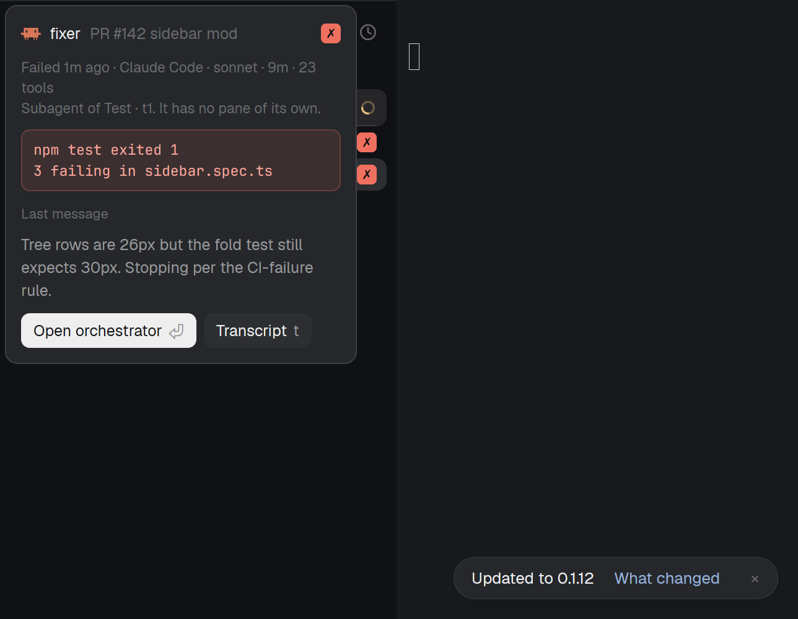
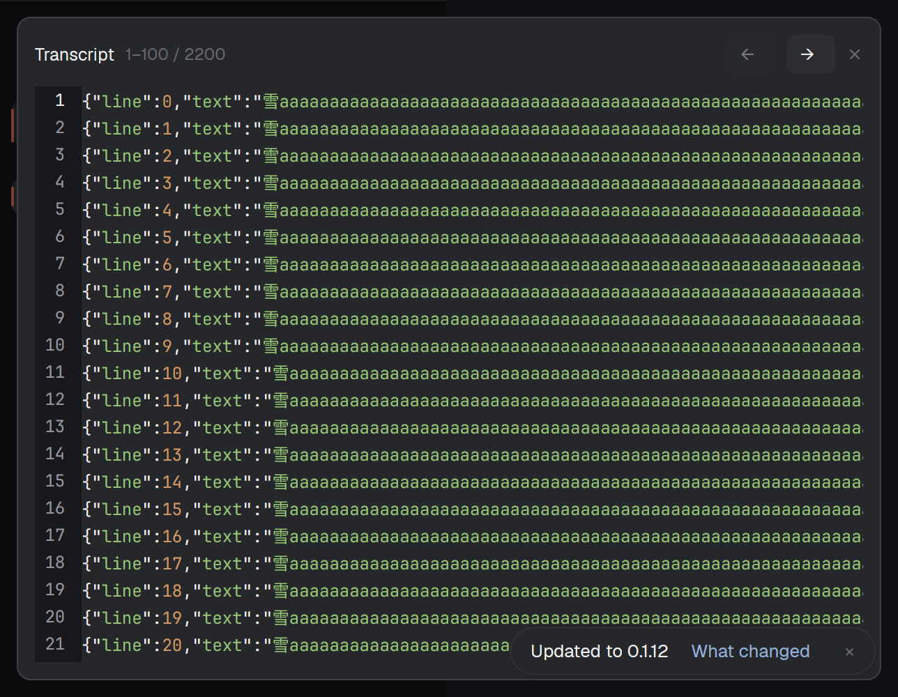
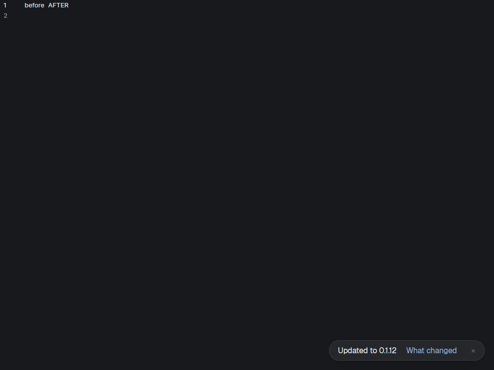

# B4 native Peek and transcript evidence

These captures use the actual Peek source identified by SHA256 in [native-provenance.json](native-provenance.json), a synthetic registered current-generation feed, and the optimized merged private panorama artifact. The private child validated its receipt/control/artifact before rendering. The basic smoke now uses the actual sidebar caller/helper and child callback route. Its private fixture aliases sidebar startup to the normal consumer role, so the seeded feed stays available; receipt/control/artifact checks run unchanged. The graph caller is compiled and covered by existing relevant checks; full installed assembly and installer acceptance follow the remaining integration handoff.

Compared with final frame C: 284 logical width, padding12/gap9, icon16, semibold role, dim thread, supplied status/model/duration/tools, error box, last message and both design buttons. Native current-theme colors and borders remain visible. The actual owned tab label is `t1`, so the context occupies one line rather than the design's longer title. The surrounding window is an isolated seeded sidebar, not the full design layout. Its popup follows the private window's default pointer location; this callback smoke does not claim a hardware click. The caller specifies the declared `frame:"none"` so the mod draws the single designed border: [pinned primary wrapper source](https://github.com/herdrdev/herdr-app/blob/v0.1.12/src/window.rs#L4185) otherwise adds its own border/background. The host update toast is unrelated to the mod.

The production caller-owned replacement uses a new token before awaiting validation or opening, stores its returned overlay ID, then closes its previous overlay. The old close acknowledgement does not clear the replacement. The same owned mod displays a native readonly Editor with actual range1–100/2200; the basic next-page callback produced101–200 with one overlay and app errors[]. Dialog size is clamped to the private viewport. Closing releases EditorState. The payload is a local synthetic JSONL file over1MiB, passed literally through existing local `hc file read` with line offset/limit; no shell, writes, URI/cwd guessing, remote routing, or external editor.

The earlier bounded native read demonstrated exact EditorState.value including NUL and following characters, with `AFTER` visibly preserved. Other existing proof records include UTF8/CRLF, literal metacharacter paths, native output bounds, raw oversized/escape-expanded-line errors and preservation of the previous valid page on failure. Line paging does not represent an immutable whole-file snapshot. A single oversized response is unavailable with its raw API error; no truncation, skip or fallback occurs.

Existing lifecycle proof covers DOT string delivery, programmatic close, replacement/old acknowledgement, native open failure preserving an unrelated overlay, and viewport clamping. Targeted synthetic Escape reached the owned close callback, but is not hardware-input proof. Synthetic outside-click delivery was not accepted; no global-focus guard was bypassed. Further input/corner-case automation is deferred by operator direction, with existing coverage retained.

Followups: [Peek/transcript native integration #144](https://github.com/LeaveMyYard/herdr-panorama/issues/144), [assembled E2E #143](https://github.com/LeaveMyYard/herdr-panorama/issues/143), [extended input/visual/performance #146](https://github.com/LeaveMyYard/herdr-panorama/issues/146). No operator content, layout or configuration was used or changed. The captured owned app closed and its exact private core process exited after scoped shutdown; no post-stop status call restarted it.
