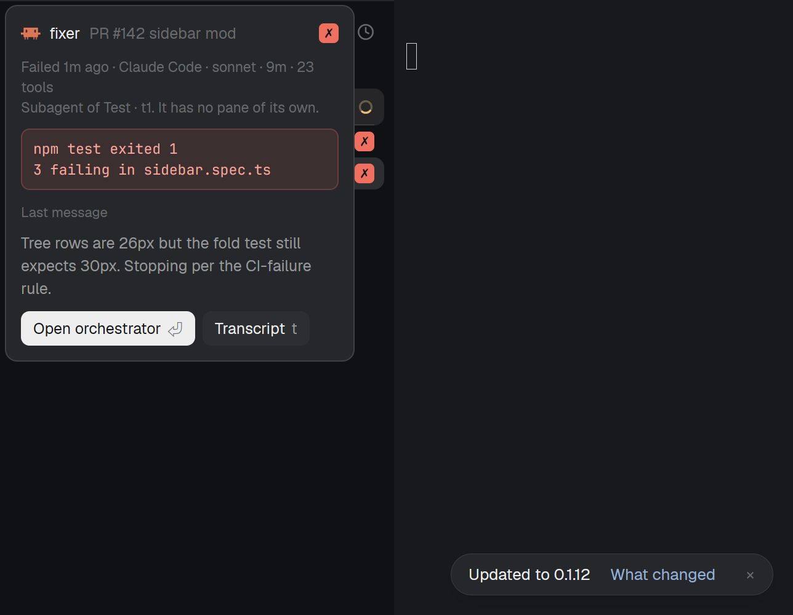
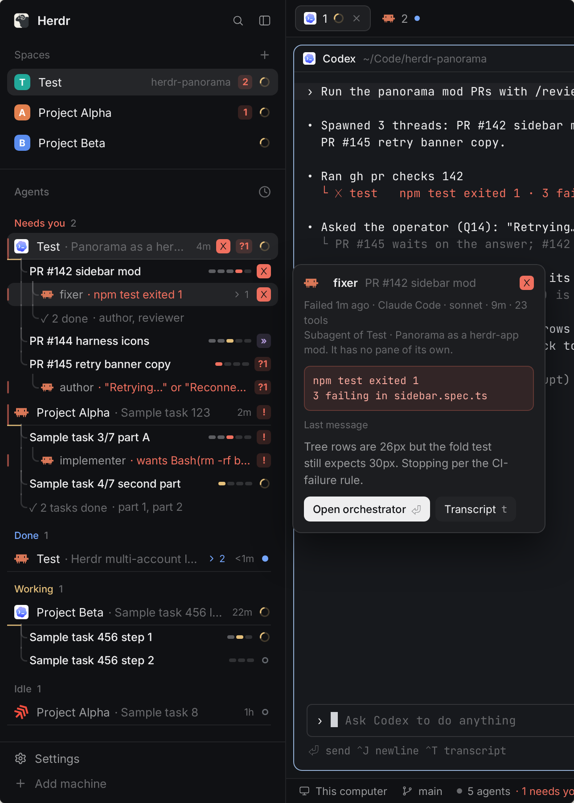
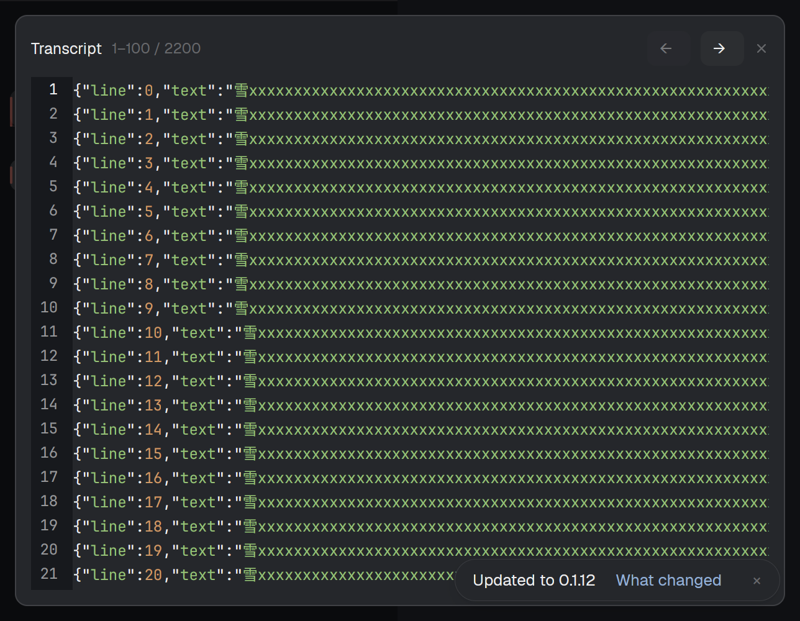

# Independent B4 native preparation

Captured independently by `/root/reviewer_a` at source
`b06323cb54d36a2c2b4a390e405340a3b802b29e`, before the frozen B4 PR.
This is preparation evidence, not an exact-final-head review verdict.

| Independent native capture | Final design reference |
| --- | --- |
|  |  |

The capture uses the actual production Peek class through a subclass that adds
diagnostic and callback commands; it inherits rendering unchanged. The production
caller helper is unchanged. The private sidebar's import aliases `startSidebar`
to the existing `startConsumer` solely to keep the supplied synthetic current-G
packet from being replaced by real writer collection. Its rendering is unchanged.
This is a seeded native rendering/caller/reader smoke, not assembled installer or
sidebar-producer acceptance. The scratch probe did not modify product source.

The popup measures 568 physical pixels wide at zoom 2, matching the specified
284 logical pixels. Native theme tokens, border, rounded container, padding,
error box, metadata, message and button arrangement are visible. The fixture's
owning title is `t1`, and the installed stock dark palette differs from the design
export. Default pointer anchoring placed the popup at the private window's top
left; pointer location and visible row-highlight geometry were not exercised.
The stock update toast is unrelated to B4. These captures do not establish whole
Frame C pixel equality, hardware click/keyboard behavior, or the deferred input
and performance matrix.

The basic smoke invoked existing production callbacks using fresh native command
contexts. Peek overlay `o1` became Transcript `o2`, with a new caller-local token
and only `o2` owned afterward. The old close acknowledgement did not clear the
replacement. The supplied literal local path includes spaces, quotes, shell
metacharacters and Unicode; it was passed as data to local `hc file read`, with
no `--on` or shell. The synthetic UTF-8 JSONL file has 2,200 lines and 2,258,290
bytes. Native readonly Editor readback matched the exact source SHA256 for
pages 1–100 and 101–200. Child close cleared the current caller/highlight key and
owned overlay set. Native app error arrays were empty.

The app used private HOME/config/state/runtime/app-home and unique HC_SESSION.
All six exact environment values, captured core PID/start, socket inode and
private app identity were verified before structural commands. Its private
optimized Panorama artifact was hash checked against the receipt and exercised
through the unchanged current-G private-command proof. The source's Rust `src/`
tree equals the artifact source base `1269dacc`. The app exited and the captured
private core exited after scoped stop code 0; no status call followed stop.
The shared runtime lock was released.

[Provenance](native-b063.json) records source/package/runtime file hashes,
artifact, generation, app binary, native diagnostics and capture hashes. The
source/static check run passed all 11 existing B4 tests, bundle `--check`, diff
check, and all six native mod checks. No new automated feature coverage was
added. Initial private fixture attempts were corrected for the SDK's HOME read
root and compare-before-write diagnostic API; those scratch failures are retained
outside the repository and are not product failures.

The final frozen review must compare the relevant source bytes with this
checkpoint before reusing these pixels. Followups remain
[#144](https://github.com/LeaveMyYard/herdr-panorama/issues/144),
[#143](https://github.com/LeaveMyYard/herdr-panorama/issues/143), and
[#146](https://github.com/LeaveMyYard/herdr-panorama/issues/146).
