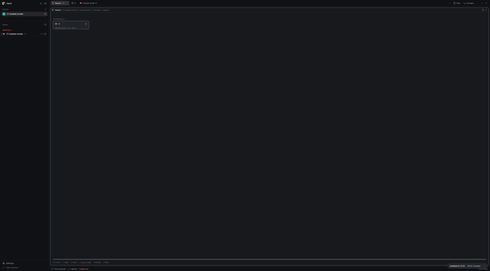

# C1 short private assembled smoke

Author manual observation on source `87bfdd5ed1b93adb53bc53899afa940fe822ce0c`:
base `ef22f7d09149c066001e0647082a71d7b173161d` plus exactly released B4
`1f10c156a3c052d12109f02cdbe76b99bbc53579`. This was the explicitly authorized
private runtime overlap, before the later Peek typography correction and final
B4 merge. It is not an independent review or final whole-package equality claim.

The actual six-mod package and default managed native checker installed into an
owned HOME/app/config/state/runtime/HC session. The reviewed optimized Rust
artifact SHA256 was
`da6d69e802a479d47aa154d3e6464c7286d0c06ef25304c9ca5a22e0aec328f2`
(9,964,424 bytes, mode 0755); its Rust src tree matched merged A3 `1269dac`.
Native versions: herdr-app 0.1.12 and hc 0.1.17. No diagnostic package override,
feed injection, frontend-role alias or model invocation was used.

## Actual basic chain

The existing minimal native OSC reporter ran as private terminal t1. Core PID,
start identity, executable, environment, private socket and zero initial terminals
were verified before structural commands. Native app membership adopted t1 into
the private space. Actual private Rust writer collection reached the canonical
frontend in generation `d2f0aa050e9d94ae7253e63f31b287b7`, fresh with stale=false.
Changing the reporter from working to blocked reached real core status, feed,
app terminal membership and the canonical shared packet.

The settled native frame shows the same t1 root, Needs you 1, space needs count 1
and selected Swarm blocked-root card. App status errors were empty. Swarm creation,
moving to index 1 and selection used actual app CLI commands, not physical input.

Capture: 3840×2128 physical pixels, app zoom 1.2. The first shot contained the
initial empty/main frame despite updated model/packet; it was rejected. A scoped
private-window maximize produced this settled frame. That native geometry action
did not touch the operator's window or global input/focus. The app answered the
recorded status RPC in about 3ms and rendered the updated root/count/graph. The
needs border/static mark is visible; no temporal animation or CPU measurement
was performed. This is basic assembled responsiveness evidence, not a performance
or pixel-for-pixel design acceptance matrix.

t1 intentionally had **session_id=null and zero transcript threads**. The feed
honestly reported session ownership unavailable and inbox source unavailable.
This proves current native-root ingestion/display, not rich transcript ingestion
or natural coverage of preexisting operator sessions. Peek was not instantiated;
later Peek typography pixels are outside this capture's scope.

## One active used-home uninstall and cleanup

The same actual installer uninstalled while the native frontend remained open.
It returned 0 in 0.229s; the real writer's already captured pidfd confirmed
cooperative exit without a writer signal. Runtime/receipt/private payload were
removed. Owned personal.txt and keys.json bytes/modes were preserved. Exactly
the approved null slots remained in shared state; this run also retained the
approved `data/panorama-tabs/store.json`. No graph store remained. Spaces preference
retention/reinstall permutations were not repeated here.

The private app exited 0. Only recorded owned terminals were stopped, then the
verified private core was stopped. Its captured pidfd confirmed exit and the
private socket disappeared; no hc query followed stop. All five captured owned
PIDs were absent and runtime.lock was free. Raw private scratch was retained as
evidence, without a running app/core/writer or live socket.

## Evidence and limits

- [manual-smoke.json](manual-smoke.json): setup, native versions, actual source,
  artifact/generation, install, observations and lifecycle results.
- [source-components.json](source-components.json): exact exercised-source/package
  file hashes for later final-merge qualification.
- [core working](core-working.json), [core blocked](core-blocked-response.json),
  [app membership](app-membership-response.json), [native status](native-status.json),
  [working feed](feed-working.json), [blocked feed](feed-blocked.json),
  [canonical packet](canonical-packet.json), [owned cleanup](owned-cleanup.json).

Existing independent slice evidence remains separate: [B2 sidebar](../b2/REVIEWER.md),
[B3 graph/preference evidence](../b3/FINAL.md) and
[B4 Peek/transcript review](../b4/reviewer/README.md). Their synthetic renderer,
callback and source provenance is not converted into rich real-collector proof.

No new automated harness, input/paging/reinstall matrix or feature tests were
added. Deferred automation: [rich assembled #143](https://github.com/LeaveMyYard/herdr-panorama/issues/143),
[Peek/transcript #144](https://github.com/LeaveMyYard/herdr-panorama/issues/144),
[retained preferences/reinstall #145](https://github.com/LeaveMyYard/herdr-panorama/issues/145),
[extended native input/visual/performance #146](https://github.com/LeaveMyYard/herdr-panorama/issues/146).

C1 is now synced with actual B4 integration merge
`9b8736f9f7784d4308a79a805ec8fb030b99a755`. The
[final source qualification](final-source-qualification.json) compares all 95
recorded component files: 94 match; only the unused Peek button/shortcut typography
changed. Every displayed component, shared closure, layout and installer matches,
and Rust build inputs remain equal. This permits reuse for the stated basic scope;
it does not claim corrected Peek pixels or whole-package byte equality.

Public raw JSON replaces task scratch/worktree/native executable paths with
explicit placeholders; original owned evidence remains in private scratch.
Artifact, component and capture hashes retain their actual values.

Independent review/CI remain gates. No operator
content/config/TUI install/layout was changed; no live installation was performed.
Root owns any later live installer action. Main still requires the operator's
own installed-layout visual approval.
