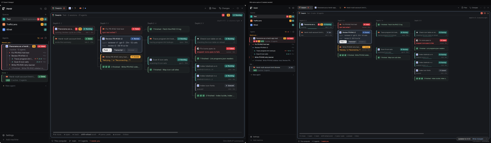
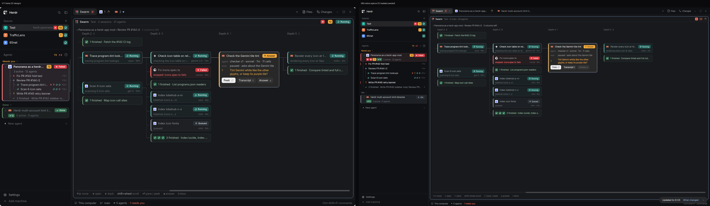

# U8b evidence: the uniform agent graph (panorama-graph on feed v2)

These are the author's captures of source `c2e5a7b1b29436cf92ffde3d0f43dec2aabc9e5e`, drawn by the native herdr-app renderer. The setup is isolated: a temporary `HERDR_APP_HOME`, its own HOME/XDG dirs and a private `hc` core. The data is the synthetic `SW2`/`DEEP` dataset from `state-refresh-v11/fixture.js` (titles from its `NAME` table), mapped onto the feed v2 fixture shape. Root terminals are synthetic OSC reporters in the private core. A scratch-only wrapper publishes the packet through the sidebar and seeds the graph's selection: `Review PR #144 r2` at depth 1 (D) and `Check the Gemini tile tint` at depth 4 (D2). Every card, the layout, the window and the navigation are drawn by the product source. There is no operator content, and no live install, layout switch of the operator's app or config edit. File hashes and isolation facts are in [capture.json](capture.json); app status was `errors: []`.

| | |
|---|---|
|  | Left: design `v11-d-graph-tab.png`. Right: native ([full frame](native-d.png)). |
|  | Left: design `v11-d2-graph-scrolled.png`. Right: native ([full frame](native-d2.png)). |
| [native-d2-manual.png](native-d2-manual.png) | D2 after the equivalent of shift+wheel back to depth 0: the manual window moves, the depth-4 selection and its lit path stay. |

What matches:

- **Columns.** `Depth 0` holds the space's two roots, then `Depth 1…5`, one fixed 272px column per depth, with the per-column counts of the frames (2, 6, 4, 9, 1, 2). No Orchestrators or Threads column exists.
- **One card.** Roots and agents share one card: harness icon, title, badge; line 2 is the activity, then `model · age` (`tab N · age` for a root). Root cards add the aggregate need tiles (`✗ ?2 Running`).
- **Folds.** Finished siblings fold per parent into `N finished · titles` with ✓ tiles, after the live siblings.
- **Selection.** The selected card opens with its `agent` line (`reviewer v1 · gpt-5 · 21m · 52 calls`), `now`, its question, and Peek / Transcript / Answer. The path lights up.
- **Window.** D shows depths 0–3 and `depth 4–5 · 2 columns right ›`; `Check icon table on reload` shows `› 1` for its off-window child. D2 shows depths 2–5 and the title breadcrumb `‹ Panorama as a herdr-app mod › Review PR #144 r2   2 columns left`. The scrollbar thumb moves.

Known differences and limits:

- **Root activity.** Feed v2 has no root activity text, so line 2 of a root card shows its state word (`running`, `idle`) instead of the design's `running /review-cycle on 3 PRs`.
- **Fixture-driven:** the Swarm tab sits at index 0, so roots say `tab 2` and `tab 3`; the done root draws as Idle, because the stock status maps `done` to idle (existing data logic); `Answer a` is disabled because no inbox is available in the isolated home; ages are capture-relative.
- **Scale and font** as in V10: zoom 1.0 against a larger design export, and the host UI font draws semibold lighter than Inter.
- **Motion.** Still frames; running glyphs spin, needs-you tiles breathe and the edge pulse and sweep animate natively.
- **Click guard.** Not visible in a still; covered by the unchanged `ClickGuard` deadlines test in `app/tests/b3-graph.test.mjs`.
