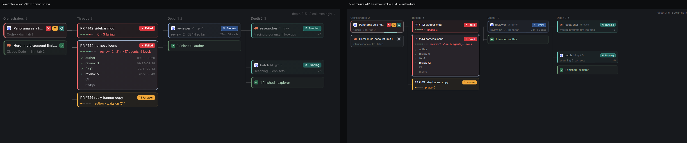
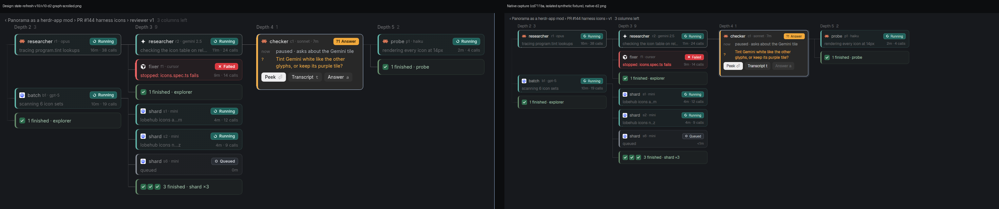

# V10 PR2 evidence: graph restyle (panorama-graph)

These are the author's captures of source `cd711baf9696b3523a4f858f0f906cc795b69f7d`, drawn by the native herdr-app renderer. The setup is isolated: a temporary `HERDR_APP_HOME`, its own HOME/XDG dirs and a private `hc` core. The data is the synthetic `SW2`/`T144`/`DEEP` dataset from `state-refresh-v10/fixture.js`, mapped onto the v1 feed fixture shape. Orchestrator terminals are synthetic OSC reporters in the private core. A scratch-only wrapper seeds the selected thread (D) and the depth-4 `checker` (D2). Every card, the layout and the navigation are drawn by the product source. There is no operator content, and no live install, layout switch or config edit. The capture recipe follows B3's `capture-final.py` (scratch, not shipped). File hashes and isolation facts are in [provenance.json](provenance.json); app status was `errors: []`.

| | |
|---|---|
|  | Left: design `v10-d-graph-tab.png`. Right: native ([full frame](native-d.png)). |
|  | Left: design `v10-d2-graph-scrolled.png`. Right: native ([full frame](native-d2.png)). |

What matches:

- **Cards.** Every card has a 3px state edge, a state-tinted body and a state border, all from `cardColors`. The selected card gets the pale `#B4C8E4` border and an outer ring. Cards on the selected path get a light border.
- **Badges.** Agent and thread badges are filled, hug their label and show `?N Answer` when there are questions.
- **Orchestrator tiles.** These are square 18px tiles: the need kinds (`✗`, `!`, `?N`), then the own state.
- **Folds.** Finished folds show green ✓ tiles.
- **Titles** keep their width. Line 2 tints to the state hue when the card needs you.
- **Action buttons.** Peek is solid; the other buttons are faint.

Known differences and limits:

- **Scale.** The native capture is at zoom 1.0, and the design export is drawn larger, so the image scale differs.
- **Font.** Badge labels request semibold, but the host UI font renders every weight about the same. They look lighter than the design's Inter SemiBold.
- **Fixture-driven differences:**
  - Phase names are `phase-N`.
  - The Swarm tab sits at index 0, so the cards say `tab 2` and `tab 3`.
  - The done orchestrator draws as idle (○), because the stock status maps `done` to idle. That is existing data logic, unchanged here.
  - `Answer a` is disabled because no inbox is available in the isolated home.
- **Motion.** These are still frames. The running glyphs spin, the needs-you tiles breathe, and the edge pulse and sweep animate natively.
- **Sidebar.** It is the existing V2 sidebar; PR3 restyles it.
