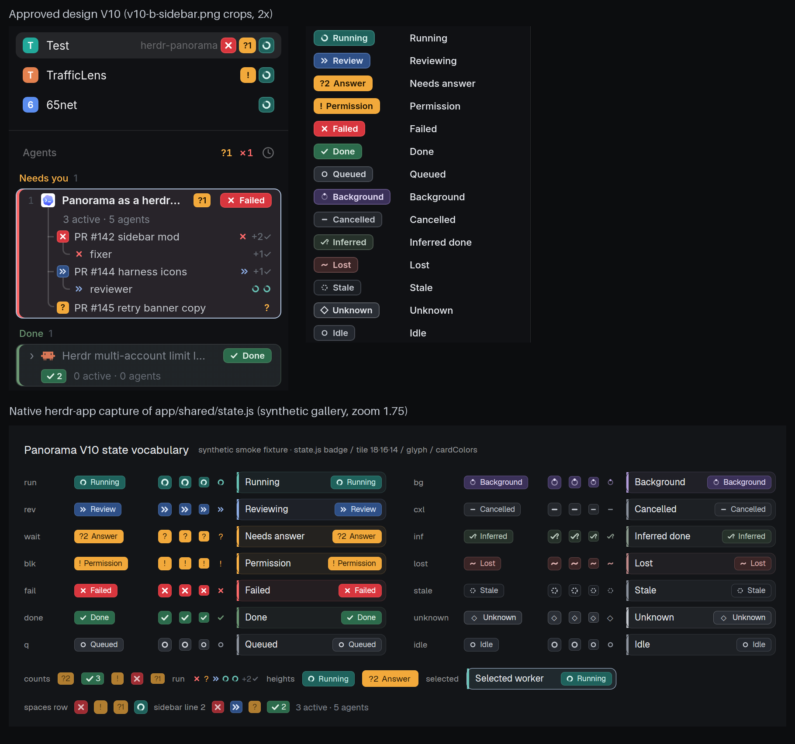

# V10 PR1 evidence: shared state vocabulary

Author capture of `app/shared/state.js` at source `b6eaf656c302603188dadee366f6fa15e9e85396`, drawn by the native herdr-app renderer. The fixture is synthetic: [gallery-fixture.js](gallery-fixture.js) is a scratch-only view that imports the generated `app/mods/panorama-graph/state.js` and its `state-*.svg` copies. It runs as `mods/panorama-graph` in a temporary `HERDR_APP_HOME`, with its own HOME/XDG dirs and a private `hc` core. There's no terminal or operator content, and no layout or config was touched. File hashes, isolation facts and app status (`errors: []`) are in [provenance.json](provenance.json).

Top: crops from the approved `state-refresh-v10/v10-b-sidebar.png` (2x). Bottom: the native capture at zoom 1.75 ([full frame](native-gallery.png)).

Each row shows `badge(state)`, `tile(state, 18 | 16 | 14)`, the bare `glyph(state)`, and a card painted with `cardColors(state)` (3px edge, tinted body, state border) and a badge. Below the rows:

- count tiles: `?2`, `✓3`, `?1`;
- a glyph run with `+2✓`;
- badge heights 20 and 22;
- a selected card with the `#B4C8E4` border;
- a Spaces-row strip and a sidebar line-2 strip.

What matches the design:

- Hues and fills come from the V10 `STATES` table (TUI `palette.rs` ST/PB).
- Badges hug their label, with no fixed width.
- Tiles are true squares, with radius 5/4/3.5.
- The SVG glyphs come from the design's `glyphs/`: spin, review, x, check, ring, orbit, minus, check-q, tilde, dashed.
- `?`, `!` and `◇` stay text glyphs, as in the design.

Known limits:

- The capture is a still frame. The running arc spins natively (`.spin(900)`), and needs-you tiles breathe 70–100% (`.loop("opacity")`). The count row's tiles were caught mid-breath, so they look dimmer. Motion isn't proven by a still.
- Badge labels request semibold. The host UI font renders them a little lighter than the design's Inter SemiBold export.
- The `+N✓` check is the SVG check glyph, not a font character.
- This PR adds no consumers. The graph is restyled in PR2, and the sidebar and Spaces in PR3.

Manual check (no new automated test): a receipt with the pre-V10 inventory (71 static files, the one installed live) still validates against the new installer manifest. The new full inventory also validates. A receipt missing an old required file, or listing an unknown file, is still refused.
